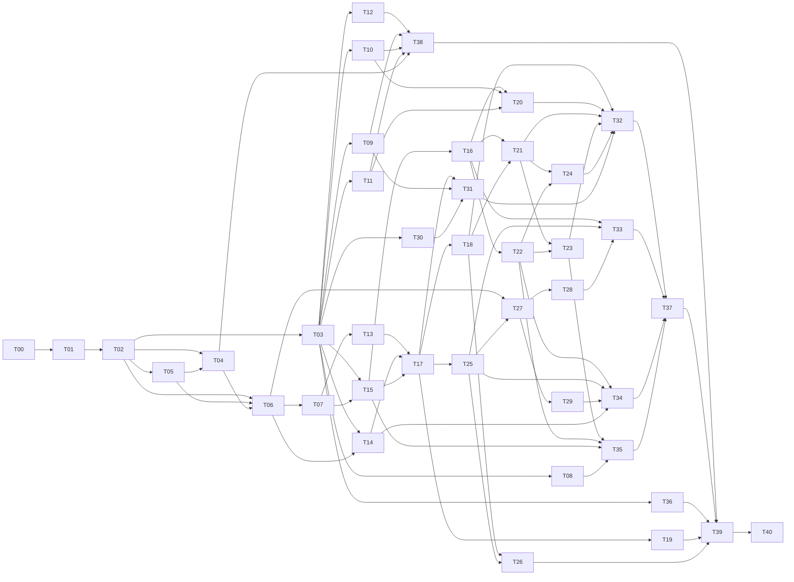

# Barbearia do Moura — PRD e guia de implementação do MVP

Versão 2.0 · 13/10/2026 · Estado: especificação consolidada e plano de construção; aplicativo ainda não implementado.

Este é o documento único de produto e de execução. Ele consolida as 81 decisões de [docs/decisoes](../decisoes/README.md), a [revisão adversarial](../decisoes/revisao-adversarial-consolidada.md) e as pesquisas de [docs/pesquisas](../pesquisas/00-como-ler.md). O plano de construção está dividido em 41 tasks em [docs/produto/tasks](tasks/README.md) e oito handoffs humanos em [docs/produto/handoffs](handoffs/README.md).

**Como usar**

| Quem | O que ler | O que fazer |
|---|---|---|
| Humano (dono do produto) | §1–§5, §10, [handoffs](handoffs/README.md) | Responder handoffs; registrar novas decisões em docs/decisoes |
| Agente orquestrador | Este PRD inteiro, [tasks/README.md](tasks/README.md), [STATUS.md](tasks/STATUS.md) | Delegar tasks prontas, integrar, parar nos gates, manter o quadro de estado |
| Subagente executor | A própria task, as seções do PRD que ela cita e os contratos publicados pelas dependências | Entregar a task fechada, com testes e relatório; parar no gate indicado |

Mapa: autoridade (§1) · problema e pesquisas (§2) · escopo (§3) · telas (§4) · regras de negócio (§5) · dados (§6) · arquitetura e APIs (§7) · qualidade (§8) · produto durante a construção (§9) · gates humanos (§10) · plano de construção (§11) · rastreabilidade (§12) · glossário (§13).

---

## 1. Autoridade, precedência e manutenção

1. **Decisões humanas** em docs/decisoes são a autoridade. Vale o texto vigente: trechos ~~riscados~~ e decisões `substituídas` não são implementados. Quando uma decisão é "parcialmente substituída", vale o trecho não riscado somado ao refinamento posterior.
2. **Este PRD** traduz as decisões em requisitos, contratos e regras de construção. Diretrizes técnicas daqui (padrões de API, testes, retentativas, segurança) são regras de engenharia, não decisões comerciais.
3. **Interpretações adotadas** estão marcadas como `INT-nn` (§5.15). São leituras conservadoras de pontos que as decisões não fecham por inteiro. Elas valem para a construção e são confirmadas em lote no handoff [H01](handoffs/H01-decisoes-residuais.md).
4. **Lacunas reais** (escolha comercial que as decisões não determinam) estão marcadas como `H01-Qn`. O ramo de código que depende delas **não é implementado com valor inventado**: a task para nesse ramo e marca `blocked_human`. O resto da task continua.
5. **Pesquisas** são evidência histórica coletada em 13/10/2026. Não aprovam funcionalidade, preço ou integração. Uma recomendação de concorrente nunca substitui uma decisão.
6. **Mudanças:** nova decisão humana → arquivo `docs/decisoes/NNNN-*.md` + índice → atualizar este PRD, as tasks afetadas, contratos e testes no mesmo ciclo. O agente nunca altera uma regra de negócio por conta própria; ele registra a divergência e para (§9.3).

## 2. Problema, proposta e síntese das pesquisas

### 2.1 Problema

- O **cliente** precisa saber o que o plano cobre, achar um horário com um profissional habilitado, marcar, remarcar e cancelar sem depender do WhatsApp do dono, e cancelar a assinatura sem ficar preso a cobranças.
- A **equipe** precisa ver a agenda, registrar o balcão (encaixes, clientes novos), confirmar o atendimento (realizado ou falta), registrar o que foi pago na hora e entender a própria comissão.
- O **gestor** precisa enxergar assinaturas, recebimentos, comissões e agenda com histórico que explique qualquer divergência, sem confundir valor vendido com caixa ou lucro.

### 2.2 Proposta

Um único aplicativo web da Barbearia do Moura, instalável como PWA, com clube de assinatura recorrente (cartão no Mercado Pago, Pix Automático na Woovi), agenda integrada à operação presencial, avulso pago no balcão e cancelamento rastreável. Não é marketplace. A primeira instalação é a Barbearia do Moura; a replicação para 3 a 5 lojas usa o mesmo código, com um deploy e um banco por loja. SaaS multiloja só depois da validação (D0012, D0019).

### 2.3 Personas e trabalhos

| Persona | Trabalho principal | Medo principal |
|---|---|---|
| Assinante | Cortar com frequência por preço fixo, no barbeiro de preferência | Ser cobrado depois de cancelar; regra escondida |
| Cliente avulso | Marcar rápido e pagar no balcão | Criar conta e esperar código |
| Cliente de balcão (pré-cadastrado) | Ser atendido; receber lembrete do horário que pediu | Receber spam |
| Barbeiro | Agenda clara, registro rápido, comissão explicável | Valor no app diferente do que recebe |
| Admin-barbeiro | Operar a cadeira e gerir a loja no mesmo login | Perder dinheiro em cobrança mal conciliada |

### 2.4 Evidências e consequências

| Evidência | Leitura crítica | Aplicação no MVP |
|---|---|---|
| [AppBarber](../pesquisas/01-appbarber.md), [objeções](../pesquisas/20-objecoes.md): cobrança após cancelar; barbearia e plataforma empurram a culpa | Relatos individuais, sem medição de incidência | Botão de cancelar do próprio cliente, protocolo imediato, devolução de cobrança pós-pedido, central de pendências (T22, T23) |
| [Clube de assinatura](../pesquisas/21-clube-de-assinatura.md): frase comercial "ilimitado" × regra da cadeira | Não importar "ilimitado" nem números de redução de falta sem estudo | Regras explícitas na adesão, no plano e em cada confirmação: 4 usos, dias, janela, limites, falta, prazo (T20, T17) |
| [Uma loja](../pesquisas/23-decisao-uma-loja.md): link da casa, sem app de loja, sem vitrine de concorrentes | Reserva sem conta foi **recusada** (D0048, D0075) | PWA, catálogo público sem horários, login para agendar, cadastro assistido no balcão (T05, T19) |
| [Mercado Pago](../pesquisas/22-mercado-pago-recorrente.md): `authorized` não é parcela paga; `back_url` não prova pagamento; webhook só traz o id; documentação contraditória sobre tópicos | Material de pesquisa não comprova a conta real | Adapter próprio, inbox durável, consulta à API antes de mudar estado, busca por `external_reference` antes de recriar, homologação em sandbox (T10, T38) |
| [Fresha](../pesquisas/05-fresha.md), [Boulevard](../pesquisas/24-boulevard.md): voucher, desconto e crédito são estados diferentes; "past due" visível | Não construir carteira genérica | Ciclo, uso, crédito de reposição e recebimento modelados separadamente (T15) |
| [Preços e monetização](../pesquisas/33-precos-e-monetizacao.md) | Usa regras antigas (clientes habilitados, falta sem consumo, um horário futuro, comissão sobre mensalidade) | Nada disso entra. Prevalecem D0020, D0025, D0026, D0023. Sem billing de SaaS |

Narrativa de origem: [reports/Apps de barbearia uma loja.md](../../reports/Apps%20de%20barbearia%20uma%20loja.md) e research_notes/ (mesmo autor, consolidados em docs/pesquisas). Referências de tela: [docs/referencias-visuais](../referencias-visuais/README.md), insumo para T05, não protótipo aprovado.

**Aprendizados aproveitados:** link direto da loja; catálogo claro; agenda por profissional; comissão explicável por lançamento; regras do clube na mesma frase da oferta; cancelamento acessível; suporte investigável com protocolo.

**Propostas de concorrentes não incorporadas:** depósito/sinal, cobrança de falta, carteira, pontos de fidelidade, lista de espera, reserva sem login, preço/duração por barbeiro, cadeira como recurso, IA atendendo cliente, estoque, NFS-e, folha, marketplace, app nativo.

## 3. Escopo do MVP

### 3.1 Incluído

- Três papéis combináveis (cliente, barbeiro, admin; admin pode ser barbeiro), uma conta por pessoa.
- Web mobile-first instalável (PWA) para cliente e equipe; backoffice desktop para gestão sensível; aba Gestão só de leitura no mobile do admin.
- Boas-vindas puláveis; conteúdo público (planos, benefícios, serviços, barbeiros) sem horários; login por OTP no WhatsApp e Google vinculado.
- Serviços, combos com componentes, matriz barbeiro × serviço (habilitação, % avulso, % assinante, vigências).
- Jornadas, intervalos, bloqueios, agenda por barbeiro, disponibilidade, encaixe e pré-cadastro pela equipe.
- Planos configuráveis e versionados, teto opcional, vaga temporária na contratação; cartão recorrente (Mercado Pago) e Pix Automático (Woovi).
- Ciclos mensais com âncora, uma quitação por ciclo, usos reservados/comprometidos/consumidos, cortesia, crédito de reposição, quatro controles de limite.
- Inadimplência sem cancelamento automático de horários; escolha explícita do cliente; reversões e contestações; devoluções; cancelamento com protocolo; troca de plano, migração de versão, reajuste com 30 dias.
- Atendimento e recebimento avulso separados; inclusão de serviço na cadeira; comissão por lançamento; correções pelo admin; fechamento mensal; repasse manual parcial.
- WhatsApp para clientes (confirmação, lembretes 24 h e 3 h, avisos essenciais, SAIR); Web Push para equipe; central de notificações e pendências por perfil.
- CRM, painel de quatro blocos, financeiro separado, auditoria, métricas operacionais, exclusão de conta diferida, backups com ensaio de recuperação e conciliação, liberação por etapas.

### 3.2 Excluído (não construir, nem "para depois" escondido)

Apps nas lojas; landing page e SEO; marketplace; multisede compartilhada; SaaS e faturamento da plataforma; split ou transferência automática; cobrança avulsa em gateway (D0029); sinal e multa por falta; pausa de assinatura (D0040); proporcional na troca de plano; plano ilimitado; incentivo ao vínculo Google; SMS ou e-mail como canal de login; simulador de margem (rejeitado em D0022); limite semanal de bloqueio do barbeiro (rejeitado em D0032); push para cliente; correção de atendimento no mobile (rejeitado em D0047); estoque, NFS-e, folha, totem, fila virtual, lista de espera, assistente de IA no app.

### 3.3 Configuração inicial aprovada

| Plano | Cobertura | Dias | Usos/ciclo | Reservas de plano simultâneas | Janela | Mensalidade |
|---|---|---|---|---|---|---|
| BLACK | Corte | Todos | 4 | 4 | 30 dias | R$ 129,90 |
| GOLD LIMITADO | Corte e barba | Terça e quarta | 4 | 4 | 30 dias | R$ 179,90 |
| PREMIUM | Corte e barba | Todos | 4 | 4 | 30 dias | R$ 199,90 |

| Parâmetro | Padrão | Fonte | Escopo |
|---|---|---|---|
| Limite geral de reservas futuras por cliente (plano + avulso) | 4 | D0060, D0081 | Barbearia |
| Antecedência mínima para o cliente marcar | 2 h | D0035, D0058 | Barbearia |
| Prazo de cancelamento sem perda de uso | 2 h (congelado por reserva) | D0058 | Barbearia |
| Grade de horários | 30 min | D0033 | Barbearia |
| Reserva temporária de vaga (plano com teto) | 30 min | D0061, D0081 | Barbearia |
| Autenticação recente para ações sensíveis | 1 h | D0071, D0081 | Barbearia |
| OTP | 6 dígitos, 5 min, 5 tentativas | D0017 | Fixo no MVP |
| Sessão | 90 dias, renovada a cada uso | D0017 | Fixo no MVP |
| Crédito de reposição | 30 dias corridos | D0059 | Fixo |
| Aviso de reajuste | 30 dias antes da renovação | D0042 | Fixo |
| Lembretes | 24 h e 3 h antes | D0045 | Fixo |
| Fuso | America/Sao_Paulo | D0080 | Barbearia |
| Teto de assinaturas | Opcional, sem valor padrão | D0061 | Plano |

Valores comerciais, marca e textos são **configuração** (D0012, D0019), nunca constantes espalhadas no código. Preços e durações de serviços, equipe, jornadas, percentuais e teto reais vêm do handoff [H04](handoffs/H04-dados-reais-e-marca.md). Seeds de desenvolvimento usam dados fictícios marcados como tais.

## 4. Jornadas, telas e permissões

### 4.1 Contrato de experiência (vale para toda tela)

- **Estados de consulta:** carregando, vazio (com próxima ação), erro recuperável (com "tentar de novo"), dados, acesso negado.
- **Estados de mutação:** enviando (botão bloqueado contra duplo envio), confirmada, **pendente externa** (com protocolo e o que acontece em seguida), conflito (com alternativas reais), falha (com mensagem segura e entradas preservadas). Nunca mostrar sucesso com base no clique, no redirect do gateway ou numa notificação enviada.
- **Disponibilidade é proposta:** a confirmação revalida no servidor; se mudou, a tela mostra a cotação atual para nova concordância.
- **Valores e datas:** dinheiro em BRL formatado a partir de centavos; datas no fuso da loja, com data completa (dia da semana, dia, mês, hora) em eventos críticos (prazos, cobranças, fim de ciclo).
- **Consequência antes da ação:** toda ação que consome uso, cria cobrança avulsa, cancela assinatura ou altera cobertura mostra a consequência em linguagem simples e pede confirmação explícita.
- **Acessibilidade:** foco visível, rótulos, navegação por teclado no desktop, feedback anunciado (aria-live), contraste AA, alvos de toque ≥ 44 px, erro não depende só de cor.
- **Deep links:** links de mensagens levam direto à tela; se exigir login, voltam ao destino depois do login; nunca carregam dado pessoal na URL.

### 4.2 Navegação por perfil

- **Visitante:** Boas-vindas (uma vez), Planos, Serviços, Barbeiros, Entrar.
- **Cliente:** Início · Agendar · Plano · Perfil (D0047). Notificações acessíveis do Início.
- **Barbeiro:** Agenda · Atendimentos · Ganhos · Perfil.
- **Admin-barbeiro:** abas de barbeiro + **Gestão**. Admin que não é barbeiro: Agenda (todas) · Atendimentos · Gestão · Perfil.
- **Papéis combinados** usam alternância de contexto ("Cliente" / "Equipe") na mesma conta. Permissões vêm sempre do servidor; esconder aba não é controle de segurança.
- **Backoffice desktop** (`/admin`) com menu lateral; acessível só a admin. No mobile, ações sensíveis mostram "Disponível no computador" com o caminho.

### 4.3 Inventário de telas

| ID | Perfil / tela | Conteúdo e fechamento do fluxo | Task |
|---|---|---|---|
| P01 | Público / Boas-vindas | 2–3 telas (marca, planos e benefícios, entrar), "Pular" sempre visível; uma vez por dispositivo e versão; nunca para logado nem para deep link; revisável em Perfil → Como funciona | T05 |
| P02 | Público / Planos e benefícios | Planos com cobertura, dias, usos, limites, regra de falta e cancelamento, preço; CTA "Assinar" leva ao login | T07 |
| P03 | Público / Serviços | Serviços e combos com preço e duração; sem horários | T06 |
| P04 | Público / Barbeiros | Lista com foto, nome e serviços que faz; sem horários | T06 |
| A01 | Todos / Entrar | Telefone → OTP → nome + aceite de Termos/Política (primeiro acesso) → destino; Google com verificação do WhatsApp na primeira vinculação; estados de código expirado, bloqueado, limite e indisponibilidade do WhatsApp | T04 |
| A02 | Logado / Trocar WhatsApp | Verificar número novo; colisão não funde contas; histórico preservado | T04 |
| A03 | Público / Não consigo entrar | Explica conferência assistida na barbearia e gera protocolo; não revela se o número existe | T33 |
| C01 | Cliente / Início | Próximas reservas, estado do plano e saldo, pendências (escolhas de cobertura, aceites, reautorização Pix), atalho Agendar, notificações | T32 |
| C02 | Cliente / Agendar | Serviços → horário (filtro opcional por barbeiro) → barbeiro livre → revisão (itens, cobertura, uso consumido, parte avulsa com preço "pago na barbearia", duração, prazo de cancelamento, avisos) → confirmação | T17 |
| C03 | Cliente / Reserva | Detalhe; cancelar (dentro do prazo / tardio com aviso); remarcar; escolha de cobertura (regularizar, avulso com aceite, cancelar sem penalidade); aceite/recusa de transferência | T18, T21 |
| C04 | Cliente / Assinar plano | Comparação, regras explícitas, vaga e prazo da vaga, cartão (campo seguro) ou Pix (aviso do nome do recebedor), autorização no banco, estados pendente/recusado/ativo | T20 |
| C05 | Cliente / Plano | Ciclo atual e saldo, reservas que usam o plano, créditos de reposição, previsão da renovação, pagamentos, regularizar, trocar plano, reajuste e reautorização, migração de versão, cancelar e protocolo | T32 (+T21–T24) |
| C06 | Cliente / Perfil | Dados, WhatsApp, Google, lembretes on/off, termos aceitos, Como funciona, sair, excluir conta e data prevista | T32 (+T04, T31, T35) |
| C07 | Cliente / Minhas reservas | Futuras e passadas, com estado e desfecho | T32 |
| B01 | Equipe / Agenda | Dia/semana; barbeiro vê a própria, admin vê todas; criar bloqueio em horário livre; admin cancela pela casa ou transfere; conflitos de jornada | T14, T18 |
| B02 | Equipe / Novo agendamento | Buscar cliente (dados mínimos) ou pré-cadastrar (nome + telefone + "cliente pediu este horário"); serviços; encaixe fora da grade; justificativa para exceder o limite geral; cotação com cobertura | T19 |
| B03 | Equipe / Atendimentos | Pendentes de desfecho; realizado/falta; recebimentos (forma, valor) com pendente/parcial/quitado; incluir serviço com aceite; registrar concordância de balcão | T25, T26, T21 |
| B04 | Equipe / Ganhos | Extrato mensal por lançamento: origem, base, percentual, valor, ajustes, status do período, repasses | T27, T29 |
| B05 | Equipe / Instalação e push | Instalação guiada do PWA (iOS e Android), permissão e teste de push, estado da entrega | T30 |
| N01 | Todos / Notificações | Lista por perfil, lida/não lida; pendências abertas/resolvidas; abrir aviso não resolve pendência | T30 |
| G01 | Admin mobile / Gestão | Quatro cartões só de leitura (assinaturas, receita, comissões, agenda e pendências), alertas, "Abrir gestão completa" | T34 |
| D01 | Admin desktop / Painel | Quatro blocos com período e drill-down | T34 |
| D02 | Admin desktop / Clientes (CRM) | Busca, lista, pré-cadastros; ficha: assinatura, ciclos, saldo, reservas, faltas, pagamentos, aceites, histórico; ações: cancelar assinatura, conceder/devolver uso, agendar troca | T33 (+T23, T24, T28) |
| D03 | Admin desktop / Agenda | Todas as agendas, encaixe, cancelar pela casa, transferir com concordância, conflitos | T14, T18, T19 |
| D04 | Admin desktop / Equipe | Membros, papéis, revogação imediata, matriz habilitação × % avulso × % assinante com vigência | T04, T06 |
| D05 | Admin desktop / Serviços | Serviços e combos (componentes), preço, duração, fotos; bloqueio de combos equivalentes | T06 |
| D06 | Admin desktop / Planos | Planos, versões, limites, teto, reajuste com aviso de 30 dias, migração de versão | T07, T24 |
| D07 | Admin desktop / Jornadas | Jornada e intervalos por barbeiro, exceções, prévia de conflitos antes de salvar | T14 |
| D08 | Admin desktop / Financeiro | Recebido, pendente, devolvido, taxas (incluídas/descontadas), comissões; ocorrências de gateway, devoluções, conciliação | T34, T22 |
| D09 | Admin desktop / Comissões | Períodos, fechar mês com alerta, repasses parciais, saldo | T29 |
| D10 | Admin desktop / Correções | Corrigir desfecho com antes/depois e efeitos em uso, comissão e recebimento | T28 |
| D11 | Admin desktop / Configurações | Marca, parâmetros, textos legais versionados, saúde das integrações (sem segredos), versão instalada | T08, T12 |
| D12 | Admin desktop / Suporte | Recuperação assistida, casos, incidentes, pendências de integração | T33, T36 |
| D13 | Admin desktop / Privacidade | Exclusões agendadas, bloqueios (ciclo, crédito, devolução), conclusão | T35 |

### 4.4 Autorização por operação

| Operação | Cliente | Barbeiro | Admin | Auth recente (1 h) |
|---|---|---|---|---|
| Ver catálogo público | sim (sem login) | sim | sim | não |
| Ver disponibilidade e cotar | próprio | própria agenda (balcão) | todas | não |
| Criar/cancelar/remarcar reserva | próprias | na própria agenda | qualquer | não |
| Bloqueio | — | próprio, só em livre | qualquer | não |
| Jornada | — | ver a própria | editar | não |
| Transferir / cancelar pela casa | — | — | sim | não |
| Primeiro desfecho e recebimento | — | próprios atendimentos | todos | não |
| Incluir serviço no atendimento | — | próprios atendimentos | todos | não |
| Corrigir desfecho; conceder/devolver uso | — | — | desktop | **sim** |
| Contratar, trocar, cancelar assinatura | própria | — | pelo cliente (com motivo) | sim (admin) |
| Fechar período; registrar repasse | — | — | desktop | **sim** |
| Papéis, planos, serviços, integrações, configurações | — | — | desktop | **sim** |
| Ver CRM e financeiro | — | dados mínimos dos clientes da própria agenda | tudo | não |
| Ver ganhos | — | próprios | todos | não |
| Recuperação assistida; concluir exclusão | — | — | desktop | **sim** |

Regras: cliente acessa só recursos próprios (verificação por `owner_id` no servidor, nunca pelo id da URL). Busca de cliente pelo barbeiro devolve só nome, telefone mascarado e se tem plano ativo. Revogar papel de equipe invalida sessões de trabalho e assinaturas de push na hora; se a pessoa também é cliente, mantém a conta de cliente sem poderes de equipe (D0071). User-agent e largura de tela não são controles: a API exige papel admin e autenticação recente.

## 5. Regras de negócio e exceções

Cada regra lista as decisões de origem e as tasks responsáveis. "Defensivo" lista o que o código deve rejeitar ou tratar mesmo que a interface não permita.

### RN01 — Identidade, sessão e acesso (D0017, D0070, D0071, D0002, D0046)

- Conta = UUID permanente. Telefone normalizado (E.164) é atributo **verificado** e **único entre vínculos ativos** da instalação. Google é identidade vinculada.
- OTP: 6 dígitos, 5 min, 5 tentativas por código, uso único, armazenado como hash. Reenvio invalida o código anterior e **não** zera contadores de abuso. Limites de envio por telefone e por IP e de verificação por desafio (valores técnicos configuráveis; padrão proposto: 3 envios/15 min por telefone, 10 envios/h por IP).
- Primeiro acesso: telefone → OTP → nome → aceite de Termos e Política (versão, data/hora, canal). Google: na primeira vinculação, verificar o WhatsApp por OTP; depois entra pelo Google sem código. Vincular contas exige provar os dois vínculos; igualdade de e-mail ou telefone digitado não vincula.
- Sessão de 90 dias, renovada no uso, cookie `httpOnly`, `secure`, `sameSite=lax`, revogável no servidor. Guardar `auth_time` para autenticação recente (1 h configurável).
- Troca de WhatsApp: só logado; verificar o número novo; se o número novo pertence a outra conta ativa, **rejeitar** e orientar conferência assistida (nunca fundir contas).
- Pré-cadastro (D0034): conta com estado `pre_cadastrado`, telefone **não verificado**, registro de quem cadastrou e do pedido do horário. Ativação = login com OTP no mesmo telefone; preserva histórico e preferências (inclusive SAIR, D0073).
- Recuperação sem acesso (D0070): caso aberto pelo admin no desktop, com autenticação recente; conferência presencial; registro de método, conclusão e motivo; verificar o novo WhatsApp; revogar sessões antigas; auditar. Posse do número **nunca** transfere histórico sozinha. Procedimento final aprovado em [H03](handoffs/H03-identidade-e-privacidade.md).
- **Defensivo:** número reciclado (telefone de conta ativa recebendo OTP de novo dispositivo) entra normalmente por OTP — é o risco aceito de D0017/D0070; mas a **troca** de telefone e a **ativação** de pré-cadastro cujo número já pertence a conta ativa são bloqueadas e viram caso de suporte. Mensagens de erro do login não revelam se o número existe.
- Tasks: T04 (núcleo), T33 (recuperação assistida), T30 (revogação de push).

### RN02 — Catálogo, combos, preço e habilitação (D0023, D0033, D0037, D0049, D0065, D0066)

- Serviço: nome, preço cheio (centavos), duração (min), ativo. Duração igual para todos os barbeiros.
- Combo: serviço com componentes (≥ 2 serviços simples), preço e duração próprios. Cadastro **rejeita**: combo com os mesmos componentes de outro combo ativo (comparar conjunto canônico ordenado), combo dentro de combo, autorreferência, componente inativo.
- **Combo equivalente automático:** se a seleção do cliente é exatamente o conjunto de componentes de um combo ativo, a cotação substitui pelo combo e mostra o ajuste antes de confirmar.
- Cobertura do combo: inteiro coberto ou inteiro avulso → preço/referência e duração do combo. Parcialmente coberto → divide em componentes: componente coberto com referência própria; não coberto com preço avulso próprio; duração continua a do combo.
- Habilitação: barbeiro × serviço (sim/não). Para atender uma visita, o barbeiro precisa estar habilitado para **todos** os itens, inclusive o combo **e** seus componentes. Barbeiro novo nasce sem habilitações.
- Percentuais: % avulso e % assinante por barbeiro × serviço, com **vigência** (início, fim aberto). % assinante padrão = % avulso no cadastro. Nova vigência não altera lançamentos passados.
- **Valores preservados na reserva:** preço avulso de cada item avulso e valor de referência de cada item coberto ficam gravados na confirmação. Mudança de preço ou duração vale só para reservas novas.
- Tasks: T06 (cadastros), T13 (cotação).

### RN03 — Agenda, disponibilidade e reservas (D0026, D0032–D0036, D0060, D0069, D0074, D0081)

- **Jornada** semanal por barbeiro (dias, início, fim, intervalos) definida pelo admin. **Bloqueio** pontual criado pelo barbeiro só em intervalo livre; admin é notificado e pode desfazer; admin bloqueia qualquer agenda.
- **Ocupação** de agenda = intervalos `[início, fim)` de reservas confirmadas e bloqueios ativos, **sem sobreposição por barbeiro** (constraint de exclusão no banco). Uma reserva pode começar exatamente no fim da outra.
- **Duração da visita:** soma das durações dos itens (combo usa a própria), arredondada para cima até múltiplo da grade (30 min).
- **Slots do cliente:** começam em múltiplos de 30 min, dentro da jornada menos intervalos, bloqueios e ocupações; respeitam antecedência mínima (2 h) e o horizonte (janela do plano para itens cobertos; para avulso, ver INT-09).
- **Fluxo padrão:** serviços → horário → barbeiros livres e habilitados → escolha. Sem barbeiro no horário: sugerir o horário/barbeiro mais próximo disponível. **Filtro opcional por barbeiro:** só horários em que ele está livre e habilitado para todos os serviços.
- **Equipe:** barbeiro marca na própria agenda, admin em qualquer; encaixe fora da grade e da antecedência mínima permitido; **nunca** sobreposição nem barbeiro não habilitado. Fora da jornada: ver INT-08.
- **Quatro controles independentes** (D0060), conferidos na confirmação, dentro da mesma transação:
  1. **saldo de usos** do ciclo da data do atendimento (ou crédito válido);
  2. **reservas de plano simultâneas** (padrão 4 por versão de plano);
  3. **limite geral** de reservas futuras do cliente, plano + avulso (padrão 4); a equipe pode exceder com **justificativa registrada**; o cliente não;
  4. **teto de assinaturas** do plano (só na contratação, RN06).
- Cortesia aumenta saldo, **não** limite. Reservas mantidas durante suspensão continuam contando nos limites.
- **Mudança de jornada** mostra cada reserva em conflito; o admin escolhe por reserva: manter como exceção, transferir (com concordância do cliente) ou cancelar pela casa (RN04). Mudança de duração de serviço não altera reservas existentes (D0069).
- **Defensivo:** a confirmação revalida tudo (cotação, revisão de preços, habilitação, jornada, ocupação, limites, saldo, prazo) mesmo que a tela já tenha validado; duas confirmações simultâneas no mesmo barbeiro/intervalo resultam em uma `confirmada` e uma `SLOT_UNAVAILABLE` com alternativas.
- Tasks: T14 (agenda), T17 (reserva cliente), T19 (equipe).

### RN04 — Uso do plano, cancelamento, remarcação e reposição (D0025, D0040, D0058, D0059)

Etapas da alocação de uso: **reservada** (ao confirmar) → **comprometida** (ao atingir o prazo congelado na reserva) → **consumida** (desfecho realizado ou falta), sem segundo desconto.

| Evento | Agenda | Direito (uso) | Comissão / dinheiro |
|---|---|---|---|
| Confirmar reserva coberta | Ocupa | 1 uso reservado no ciclo da data (pago) ou previsão (ciclo futuro não pago) | Nada |
| Atingir o prazo sem perda | Mantém | Mesmo uso fica comprometido | Nada |
| Realizado | Desfecho | Uso consumido (mesmo uso) | Comissão (% assinante sobre referência preservada) |
| Falta (com ciclo pago) | Desfecho | Uso consumido; sinaliza admin no CRM | Sem comissão; sem multa |
| Cliente cancela **antes** do prazo | Libera | Uso volta (crédito volta com a validade original) | Nada |
| Cliente cancela **depois** do prazo (tardio) | Libera na hora; equipe notificada | Uso comprometido consumido | Nada; avulso sem custo |
| Falta durante suspensão sem ciclo pago | Desfecho | Não consome uso; sinaliza admin | Sem cobrança |
| Barbearia cancela, benefício pago | Libera; cliente avisado com link para remarcar | Uso substituído por **crédito de reposição** (30 dias) | Nada |
| Barbearia cancela, previsão não paga | Libera | Previsão liberada, sem crédito | Nada |
| Transferência recusada pelo cliente | Libera | Igual a cancelamento pela casa | Nada |

- **Instante do prazo:** `cancel_deadline = início − prazo_configurado`, congelado na confirmação. `agora < deadline` → dentro do prazo; `agora ≥ deadline` → comprometido. Testar os dois lados e a igualdade.
- Se a reserva já nasce com `agora ≥ deadline` (encaixe ou configuração com antecedência < prazo), a revisão avisa que o uso fica comprometido na hora e exige concordância.
- **Remarcar** = cancelar + criar numa operação: mostra a consequência da reserva antiga; revalida o novo horário; só libera a antiga se a nova for confirmada; se a antiga já está comprometida, remarcar é cancelamento tardio + nova reserva (o uso comprometido não volta) — a tela deixa isso explícito.
- **Crédito de reposição:** mesmas condições da versão de plano original (serviços, dias); válido por 30 dias corridos a partir do cancelamento pela casa; não exige assinatura ativa; não muda cobrança; quando usado, gera comissão de assinante. Reserva com crédito: cliente cancela dentro do prazo → mesmo crédito, validade original; tardio/falta → consumido; casa cancela de novo → mesmo crédito com 30 dias reiniciados. **Um** crédito por direito substituído; nunca devolver o uso original e criar crédito ao mesmo tempo.
- Depois do início do horário, o cliente não cancela nem altera; a equipe registra desfecho; o admin corrige.
- **Defensivo:** job de comprometimento e desfecho concorrentes não podem consumir duas vezes (transição condicional por estado + revisão). Comprometimento é derivado do relógio; o job só materializa a transição de forma idempotente.
- Tasks: T15 (ledger), T18 (cancelar/remarcar/casa/transferência), T25 (desfecho).

### RN05 — Assinatura, cobrança e calendário (D0004, D0008, D0018, D0025, D0052, D0080)

- O estado local da assinatura é **próprio** e independe do enum do gateway. Separar: autorização (recorrência no provedor), obrigação (mensalidade de um ciclo), tentativa/pagamento, quitação, ciclo e direito.
- **Autorização, checkout concluído ou `back_url` não liberam usos.** Só **pagamento aprovado confirmado por consulta à API** quita uma obrigação.
- Cada obrigação tem ID permanente. Retentativas, pagamento manual de regularização e outro provedor apontam para a **mesma** obrigação. **Uma quitação por obrigação.** Segunda aprovação → `duplicata` → devolução pendente para o admin (T22); nunca mais usos.
- **Ciclo** = `[início, fim)` mensal. Renovação no mesmo dia do mês (dia-âncora); se não existir, último dia do mês; o dia original volta quando existir (31/01 → 28/02 → 31/03). Nunca somar 30 dias. Instantes em UTC; calendário e prazos no fuso da loja.
- **Renovação em dia:** aprovação antes do fim → próximo ciclo começa no fim do anterior, mesma âncora.
- **Pagamento atrasado** (aprovado depois do fim do ciclo pago): novo ciclo começa no **instante de aprovação registrado pelo provedor**, nova âncora, usos integrais, próxima cobrança muda para a nova data (capacidade do provedor validada em H02) e a cobertura das reservas futuras é **recalculada** (RN07). Sem retroatividade: avulsos realizados antes mantêm receita e comissão. Webhook atrasado não muda o instante.
- Retentativas do provedor ficam ativas (cartão: até 4 em 10 dias; Pix Automático: mesmo dia 18–21 h e até 3 datas em 7 dias, se habilitado). Esgotadas sem aprovação → cancelar no app e no provedor com aviso (não esperar o cancelamento automático de 3 parcelas do Mercado Pago).
- **Previsões:** reservas cobertas em ciclos futuros ainda não pagos ficam como previsão do ciclo projetado pela âncora atual; viram uso pago na quitação, se couberem no saldo.
- **Defensivo:** pagamento em moeda ≠ BRL, valor ≠ esperado, conta/ambiente ≠ configurados ou referência desconhecida → ocorrência para conciliação, nunca quitação. Evento fora de ordem não regride estado mais novo.
- Tasks: T16 (núcleo), T10/T11 (adapters), T22 (devolução e conciliação).

### RN06 — Contratação e teto (D0020, D0061, D0062, D0081)

- Qualquer cliente logado pode contratar (sem habilitação prévia). Ver H01-Q3 sobre mais de uma assinatura.
- Teto opcional por **plano** (soma de todas as versões). **Ocupam vaga:** ativas; suspensas enquanto retentativas podem reativá-las; canceladas até o fim do ciclo pago; reservas de vaga não expiradas. Encerramento efetivo libera.
- Ao iniciar o pagamento, o cliente segura a vaga por 30 min (prazo exibido na tela); expira automaticamente.
- Aprovação depois da expiração: nova conferência de capacidade sob lock; havendo vaga, ativa; se a vaga foi preenchida no intervalo, **ativa excepcionalmente além do teto**, registra o excedente e bloqueia novas contratações até haver capacidade. A exceção vale só para pagamento aprovado de checkout iniciado legitimamente no app; pagamento sem checkout correspondente vira ocorrência (T22).
- Reduzir o teto abaixo do ocupado preserva quem está dentro e bloqueia novas contratações.
- Renovação nunca disputa vaga.
- Tasks: T20.

### RN07 — Inadimplência, perda de cobertura e reversões (D0053, D0054, D0063)

- Recusa antes do fim do período pago → aviso (WhatsApp + app) e pendência; **sem suspensão**.
- Fim do período pago sem aprovação → `suspensa`; sem carência gratuita; reservas **mantidas**. Para cada reserva futura que perdeu cobertura, o cliente recebe uma **escolha de cobertura** com três opções: regularizar; manter como avulso com preço explícito e aceite; cancelar sem penalidade. Sem resposta, a reserva fica mantida e a equipe obtém a concordância no balcão antes do serviço (registrada com canal "balcão" e registrador).
- Não existe job que cancela reservas por inadimplência.
- Falta durante suspensão sem ciclo pago: sem cobrança, sem consumo, com histórico e sinalização.
- Regularização aprovada → novo ciclo (RN05), recálculo de cobertura das reservas; reservas que voltam a ser cobertas dispensam a escolha; as que não cabem no saldo seguem H01-Q2.
- **Escolha de cobertura** é o mesmo mecanismo para: inadimplência, encerramento com reservas futuras, troca de plano que muda cobertura, troca não efetivada no Pix, migração de versão, reversão de pagamento e deslocamento de ciclo. Notificação nunca é aceite (D0063).
- **Reversão confirmada** pelo provedor (estorno, chargeback): reavaliar a cobertura; se nenhum pagamento válido sustenta o ciclo, suspender o restante e sinalizar o admin; reservas futuras seguem a escolha de cobertura; realizados mantêm histórico, sem cobrança retroativa nem retirada automática de comissão. **Contestação em análise** gera só pendência.
- Tasks: T21 (inadimplência e escolhas), T22 (reversões).

### RN08 — Cancelamento da assinatura (D0021, D0040, D0055, D0072)

- Cliente cancela sozinho; admin cancela pelo cliente com motivo obrigatório; exclusão de conta também dispara o cancelamento.
- Na hora: registrar data/hora e **protocolo**, desligar a renovação localmente, mostrar "solicitação registrada, aguardando confirmação do provedor". Estado da assinatura: `cancelada_no_fim_do_ciclo` (benefício até o fim do ciclo pago).
- Operação externa de cancelamento persistida e retentada até confirmação; falha persistente vira pendência do admin. A confirmação é mostrada ao cliente.
- **Vale o instante do pedido:** cobrança de ciclo iniciado depois do pedido é devolvida (T22).
- Reservas de plano com data depois do fim do ciclo: ver INT-07.
- Cancelamento feito fora do app (Mercado Pago, banco) é refletido por webhook + consulta.
- Tasks: T23.

### RN09 — Troca de plano, versões, reajuste e recorrência (D0039, D0042, D0050, D0056, D0057, D0062, D0063)

- **Troca de plano** vale no próximo ciclo, sem proporcional. Antes de confirmar, mostrar reservas do ciclo seguinte que mudam de cobertura e preços; o cliente escolhe por reserva (avulso com aceite ou cancelar sem penalidade). Admin pode **agendar** a troca, mas as escolhas de cobertura continuam sendo do cliente.
- **Cartão:** alterar valor/plano no Mercado Pago programado para a próxima renovação. **Pix:** nova autorização no banco antes da data; a autorização antiga só é cancelada depois que a nova é confirmada; sem nova autorização até a data → troca **não acontece**, cliente segue no plano antigo, avisado, e as reservas voltam às regras antigas (nova escolha se a cobertura mudar).
- **Uma recorrência responsável** pela próxima cobrança; a troca só aparece como "programada" depois que o provedor confirma; falha vira pendência visível. Nunca duas cobranças no mesmo ciclo.
- **Versões:** alterar serviços, dias, usos ou limites cria nova versão para novas contratações; assinantes mantêm a versão até **aceitarem** a migração.
- **Reajuste de preço:** vale para todos na primeira renovação ≥ 30 dias depois do aviso (WhatsApp + app, com valor antigo, novo, data e botão cancelar). Cartão: alteração na data correta. Pix: reautorização; sem ela → `cancelada_no_fim_do_ciclo`. Guardar evidência de envio do aviso; falha de entrega reabre o prazo para aquele assinante (INT-10).
- **Mudança de conta de pagamento** exige migração validada (D0057). A conta Mercado Pago de produção é do dono da barbearia e é configurada **antes** do primeiro assinante real. Woovi: conta CNPJ do dono do produto com subconta da barbearia; a tela de Pix mostra o nome que aparecerá para o pagador.
- Tasks: T24 (+T10, T11), T40 (contas definitivas).

### RN10 — Atendimento, inclusão de serviço e recebimentos (D0029, D0064, D0079)

- Equipe registra o primeiro desfecho (realizado ou falta) dos próprios atendimentos; admin de qualquer um. Horário passado sem desfecho vira **pendência** para o barbeiro e aparece no painel.
- Realizado gera comissão mesmo sem recebimento integral. Parte coberta não gera receita nova.
- **Conta a receber** por visita = soma dos itens avulsos (preços preservados + inclusões). Recebimentos presenciais com valor, data e forma (dinheiro, Pix na loja, débito, crédito na maquininha). Status calculado: pendente, parcial, quitado. Rejeitar valor ≤ 0 e soma acima do devido (excedente vira ocorrência). Estorno de recebimento é novo lançamento.
- Falta de avulso: sem custo; conta a receber cancelada com motivo.
- **Inclusão de serviço** na cadeira: barbeiro habilitado; tempo livre imediatamente após o fim da reserva para a duração adicional; preço vigente na inclusão; itens originais mantêm preço; a visita continua sendo 1 uso; combo equivalente aplicado (H01-Q1); parte avulsa exige aceite do cliente registrado pelo barbeiro. Sem tempo: rejeitar e sugerir nova reserva.
- Tasks: T25, T26.

### RN11 — Comissão, correção, fechamento e repasse (D0009, D0023, D0041, D0064, D0066, D0067)

- Lançamento por item realizado: `valor = arredonda(base × pct_bp / 10000)`, com base = referência preservada (coberto) ou preço avulso preservado (avulso), e pct = % assinante (coberto ou crédito) ou % avulso vigente **na data do atendimento** para barbeiro × serviço. Combo inteiro → linha do combo; combo dividido → uma linha por componente. Arredondamento: meio para cima, ao centavo, uma vez por lançamento; totais somam lançamentos.
- Falta não gera comissão. Lançamentos são imutáveis; ajuste é novo lançamento com referência à origem.
- **Período** = mês civil no fuso da loja. Lançamento vai para o período do atendimento se aberto; senão para o **primeiro período ainda aberto**, referenciando o atendimento e o mês de origem.
- **Fechar** (admin, desktop, auth recente): alerta de atendimentos sem desfecho no mês; congela lançamentos e totais por barbeiro. Status: aberto → fechado → parcialmente pago → quitado.
- **Repasse** manual: valor e data por barbeiro e período; aceita parcelas; mostra devido, pago, saldo; quitado só quando cobre o devido. Rejeitar repasse acima do saldo (H01-Q6 para saldo negativo após correção).
- **Correção** (admin, desktop, auth recente, motivo obrigatório): mostra antes/depois e efeitos em uso, comissão e recebimento; aplica tudo numa transação com lançamentos compensatórios; não devolve dinheiro (devolução real é processo separado). Corrigir para falta mantém o uso consumido.
- **Conceder uso extra / devolver uso consumido** (D0040): motivo obrigatório, sem efeito no gateway, sem efeito em comissão; cortesia não amplia limites (H01-Q5 para devolução de ciclo encerrado).
- Tasks: T27, T28, T29.

### RN12 — Comunicação (D0010, D0031, D0044, D0045, D0051, D0073, D0076, D0077)

- **Clientes: só WhatsApp** (WhatsMiau atrás de `NotificationProvider`). Duas configurações lógicas — `otp` e `avisos` — que no piloto apontam para a mesma instância (D0031). O WhatsApp oficial do dono fica fora.
- Mensagens ao cliente: confirmação ao agendar; lembrete 24 h e 3 h antes; avisos essenciais (cancelamento pela casa, transferência, escolha de cobertura, cobrança recusada, suspensão, regularização, cancelamento e protocolo, troca, reajuste, reautorização, migração, exclusão).
- **Lembretes** são jobs agendados por reserva e revisão. Não agendar marco já passado na criação. No envio, reconsultar: cancelada ou passada → não envia; revisão diferente → não envia (outro job cobre); prazo vigente → informa o prazo real; prazo vencido → só lembra o atendimento (D0077). Opt-out respeitado.
- **SAIR** (resposta no WhatsApp) ou opção no Perfil desligam **só lembretes**; resposta automática explica que códigos e avisos essenciais continuam. Preferência persiste na ativação do pré-cadastro.
- **Pré-cadastrado:** só confirmação e lembretes do horário que pediu (equipe confirmou o pedido), com link "ative sua conta" e SAIR; nada além disso até ativar e aceitar os termos.
- **Equipe: Web Push** (novo agendamento, cancelamento incl. tardio, bloqueio criado, assinatura suspensa, atendimentos pendentes); instalação do PWA guiada e obrigatória. Sem push para cliente.
- **Central** por perfil: notificação (lida/não lida) e **pendência** (aberta/resolvida) são coisas diferentes; abrir não resolve; a pendência fecha quando a condição de negócio é resolvida.
- **Defensivo:** falha de envio é registrada e visível (não prometer "código enviado" sem resposta do provedor); volume baixo, sem disparo em massa; payload de push sem dado pessoal desnecessário.
- Tasks: T09, T30, T31.

### RN13 — Consentimento e privacidade (D0046, D0072, D0007)

- Aceites de Termos e Política com versão (hash), data/hora, canal. Textos por barbearia, versionados, aprovados em H03.
- **Excluir conta:** interrompe a renovação na hora (RN08, com protocolo); acesso mantido até o fim do ciclo pago, uso ou vencimento do crédito de reposição e resolução de devoluções/pendências que dependem da identificação. Mostrar a data prevista e atualizá-la. Sem encerramento imediato.
- Conclusão: anonimizar dados pessoais em todos os lugares (banco, identidades de auth, sessões, arquivos no R2, payloads em inbox/outbox/entregas, logs dentro da retenção) e manter registros financeiros e de comissão sem identificação, pelo prazo definido em H03. Backups: registro de exclusões sobrevive ao restore e é reaplicado.
- Não declarar conformidade legal; não inventar prazo de retenção.
- Tasks: T35 (+T04, T31).

### RN14 — Aceites e concordâncias (D0063, D0051, D0053, D0079)

- Aceite = registro com: sujeito (cliente), objeto (reserva, proposta de cotação, troca, migração, transferência, inclusão), **hash da proposta** (itens e valores), data/hora, canal (`app`, `balcao`, `telefone`), registrador (cliente ou membro da equipe).
- Aceite registrado pela equipe significa concordância declarada pelo cliente, não leitura de mensagem. Job ou notificação **nunca** criam aceite.
- Mudança de cobertura ou preço invalida aceite anterior incompatível (proposta diferente → novo aceite).
- Tasks: T13 (proposta/hash), T21 (escolhas), T18 (transferência), T24 (troca/migração), T26 (inclusão).

### 5.15 Interpretações adotadas (validar em lote no H01)

> **2026-10-13:** todas confirmadas ([D0088](../decisoes/0088-interpretacoes-int-01-a-13-confirmadas.md)). Lacunas H01-Q1…Q6 decididas em D0083–D0087; ambiente sem Docker em D0082. Onde o PRD divergir dessas decisões, as decisões prevalecem (§1).

| ID | Ponto | Interpretação adotada | Base |
|---|---|---|---|
| INT-01 | `comprometido` | Derivado de `agora ≥ cancel_deadline`; job materializa a transição de forma idempotente | D0058 |
| INT-02 | Reserva coberta para ciclo ainda não pago | Alocação "prevista" contra o ciclo projetado; não é benefício pago; casa cancelando libera sem crédito | D0026, D0059 |
| INT-03 | Atendimento coberto por plano antes da quitação do primeiro ciclo | Não existe: sem ciclo pago, a cotação é avulsa | D0052 |
| INT-04 | Pagamento aprovado de checkout cuja vaga expirou | Sempre ativa (com vaga ou como excedente registrado); pagamento sem checkout correspondente vira ocorrência | D0061 |
| INT-05 | Assinatura suspensa e reservas novas | Cliente só marca avulso (com cotação avulsa); crédito de reposição válido continua utilizável | D0018, D0059 |
| INT-06 | Transferência de barbeiro sem resposta | Reserva mantida com o barbeiro original enquanto possível; se o original não puder atender, a casa cancela (crédito se pago) | D0063, D0069 |
| INT-07 | Cancelamento voluntário com reservas de plano depois do fim do ciclo | No próprio fluxo de cancelamento o cliente escolhe, por reserva: manter como avulso (preço explícito, aceite) ou cancelar; sem escolha, o cancelamento não é confirmado. Cancelamento pelo admin ou por retentativas esgotadas mantém as reservas com escolha de cobertura pendente | D0021 × D0053 × D0063 |
| INT-08 | Encaixe fora da jornada | Barbeiro só dentro da própria jornada (fora da grade permitido); admin pode criar fora da jornada como exceção explícita registrada | D0032, D0034 |
| INT-09 | Horizonte de agendamento avulso pelo cliente | Mesmo horizonte da janela padrão (30 dias), configurável na barbearia | D0026 (por analogia) |
| INT-10 | Aviso de reajuste não entregue | Contagem dos 30 dias parte do aviso registrado no app; falha de WhatsApp gera pendência para reenvio e não conta como aceite | D0042, D0063 |
| INT-11 | Período de comissão para crédito de reposição | Igual a qualquer atendimento coberto (% assinante, referência preservada do item) | D0059 |
| INT-12 | Taxas dos provedores | Mostrar bruto e, quando o provedor informar, taxa e líquido; se não informar, rotular "taxas não informadas pelo provedor" | D0068 |
| INT-13 | Assinante sem saldo no ciclo da data ou com o limite de reservas de plano atingido | A cotação oferece a visita como avulsa, com o motivo explícito; o cliente decide com aceite (o limite geral continua valendo) | D0027, D0060 |

## 6. Modelo de dados e invariantes

### 6.1 Convenções

- Postgres + Drizzle. UUID (v7 recomendado) em todas as tabelas. `barbearia_id` obrigatório em toda tabela de negócio, vindo da configuração do deploy, primeiro campo dos índices relevantes; FKs compostas `(barbearia_id, id)` onde houver relação entre agregados.
- Dinheiro: `*_centavos bigint` + moeda BRL implícita (validada nas fronteiras). Percentual: `*_bp integer` (pontos-base). Instantes: `timestamptz` (UTC). Datas locais: `date` + fuso da configuração. Âncora: `dia_ancora smallint`.
- Toda tabela de agregado mutável tem `revisao integer` para concorrência otimista. Históricos são append-only.
- Nenhum saldo financeiro mutável é a única evidência: saldos são somas de lançamentos (podem ter projeções materializadas, reconstruíveis).
- Tabelas internas das bibliotecas (Better Auth, pg-boss) seguem seus contratos e ficam encapsuladas em `src/platform`.

### 6.2 Agregados e tabelas

| Módulo (task dona) | Tabelas | Campos essenciais | Invariantes |
|---|---|---|---|
| plataforma (T02) | `barbearias`, `auditoria`, `chaves_idempotencia` | slug, nome, fuso; ator, ação, recurso, antes/depois reduzidos, correlation_id; chave, escopo, hash do payload, resultado | Auditoria append-only; chave única por (barbearia, ator, operação, chave) |
| durabilidade (T03) | `outbox`, `inbox_provedor`, `operacoes_externas`, `estado_recuperacao` (+ tabelas pg-boss) | evento, versão, payload, publicado_em; provedor, conta, ambiente, id do evento, hash, recebido_em, processado_em; tipo, chave, estado (`pendente`, `em_andamento`, `confirmada`, `incerta`, `falhou`), tentativas | Inbox único por (provedor, conta, ambiente, id_evento); ACK só após persistir |
| identidade (T04) | `usuarios`, `papeis_usuario`, `vinculos_telefone`, tabelas Better Auth (`user`, `session`, `account`, `verification`), `documentos_legais`, `aceites_documentos`, `casos_recuperacao` (T33) | estado (`pre_cadastrado`, `ativo`, `exclusao_agendada`, `anonimizado`), nome; papel (`cliente`, `barbeiro`, `admin`), ativo, revogado_em; telefone E.164, verificado_em, ativo; versão/hash do documento | Um vínculo de telefone ativo por número; revogação invalida sessões de equipe |
| configuração (T08) | `configuracoes` (versionadas), `arquivos` | parâmetros (§3.3), marca, textos; dono, propósito, chave R2, mime, tamanho, estado | Uma versão vigente; arquivos com prefixo da barbearia |
| catálogo (T06) | `servicos`, `combo_componentes`, `barbeiros`, `habilitacoes`, `comissao_vigencias` | preço, duração, ativo, tipo (`simples`/`combo`); perfil público, foto; barbeiro × serviço habilitado; % avulso/assinante, início, fim | Combo sem duplicata equivalente nem aninhamento; vigências sem sobreposição por par |
| planos (T07) | `planos`, `plano_versoes`, `plano_versao_servicos`, `plano_versao_dias`, `plano_precos` | nome, teto, ativo; usos/ciclo, limite de reservas, janela, versão, vigente_desde; serviços cobertos; dias; preço, vigência, aviso_em | Versão contratada imutável; preço por vigência |
| agenda (T14) | `jornadas`, `jornada_intervalos`, `bloqueios`, `excecoes_jornada`, `ocupacoes` | barbeiro, dia da semana, início, fim; intervalo, motivo, autor; tipo (`reserva`/`bloqueio`), `tstzrange`, ativo | `EXCLUDE USING gist (barbearia_id WITH =, barbeiro_id WITH =, periodo WITH &&) WHERE ativo` |
| cotação (T13) | `cotacoes` | cliente, seleção normalizada, itens, preços, cobertura, duração, deadline, hash, expira_em, revisão do catálogo | Servidor recalcula; cotação expirada ou de outra revisão não confirma |
| reservas (T17/T18/T19) | `reservas`, `reserva_itens`, `reserva_eventos` | cliente, barbeiro, início, fim, estado, origem (`cliente`/`equipe`), `cancel_deadline`, pedido_pelo_cliente, justificativa_limite, revisão; item: serviço, combo pai, coberto, preço avulso, referência, versão de plano | Snapshots imutáveis; histórico append-only |
| direitos (T15) | `direitos`, `alocacoes_uso`, `movimentos_direito`, `creditos_reposicao` | origem (`ciclo`/`cortesia`/`credito`), ciclo_id, quantidade, validade, condições (versão de plano); reserva, estado (`prevista`/`reservada`/`comprometida`/`consumida`/`liberada`/`substituida`); evento, motivo, ator | No máximo uma alocação efetiva por reserva; saldo = quantidade − alocações efetivas ≥ 0 |
| assinaturas (T16) | `assinaturas`, `ciclos`, `obrigacoes`, `pagamentos`, `recorrencias` | cliente, plano, versão, estado, dia_ancora, renovação_habilitada; início, fim, obrigação; sequência, vencimento, estado (`aberta`/`quitada`/`dispensada`); provedor, conta, ambiente, id externo, valor, aprovado_em, estado, tipo (`quitacao`/`duplicata`/`orfao`); provedor, id externo, responsável pela próxima obrigação | UNIQUE (provedor, conta, ambiente, id_pagamento); uma quitação por obrigação; ciclos sem sobreposição por assinatura; uma recorrência responsável |
| contratação (T20) | `vagas_assinatura` | plano, cliente, checkout, criada_em, expira_em, estado, excedente | Ocupação serializada por lock no plano |
| inadimplência (T21) | `escolhas_cobertura`, `aceites` | reserva, causa, opções, estado, escolhido, canal, registrador; objeto, hash da proposta, canal, registrador | Uma escolha aberta por reserva e causa |
| financeiro (T22) | `devolucoes`, `ocorrencias_pagamento` | pagamento, motivo, valor, estado (`solicitada`/`processando`/`concluida`/`falhou`), chave idempotente; tipo (`duplicata`, `orfao`, `reversao`, `contestacao`, `divergencia`), estado | Devolução não é ajuste contábil; uma por pagamento e motivo |
| cancelamento (T23) | `pedidos_cancelamento` | assinatura, protocolo, solicitado_em, solicitante, canal, motivo, estado (`registrado`/`confirmado`/`escalado`) | Protocolo único; instante imutável |
| mudanças (T24) | `trocas_plano`, `migracoes_versao`, `reajustes`, `avisos_reajuste` | origem, destino, estado (`proposta`/`aguardando_autorizacao`/`programada`/`efetivada`/`nao_efetivada`/`falhou`); versão; preço, aviso_em, vigência por assinante | Uma troca ativa por assinatura |
| atendimento (T25/T26) | `atendimentos`, `atendimento_itens_incluidos`, `contas_receber`, `recebimentos` | reserva, desfecho, ocorrido_em, registrado_em, registrador; item incluído, preço, aceite; devido; valor, forma, data, autor, estorno_de | Primeiro desfecho único; soma de recebimentos ≤ devido |
| comissões (T27/T29) | `lancamentos_comissao`, `periodos_comissao`, `fechamentos`, `repasses` | item, barbeiro, base, pct_bp, valor, tipo, competência, período, origem do ajuste; mês, estado; totais congelados; valor, data, autor | Lançamento imutável; período fechado não recebe lançamento; repasse ≤ saldo |
| correções (T28) | `correcoes_atendimento`, `acoes_direito_admin` | antes, depois, motivo, efeitos, admin; tipo (`cortesia`/`devolucao`), motivo | Append-only |
| notificações (T30/T31) | `notificacoes`, `pendencias`, `entregas`, `preferencias_comunicacao`, `push_subscriptions` | destinatário, papel, tipo, recurso, lida_em; tipo, recurso, aberta_em, resolvida_em; canal, provedor, tentativas, estado; lembretes_ativos; endpoint, chaves, ativo | Pendência fecha só por condição de negócio |
| privacidade (T35) | `pedidos_exclusao`, `registro_exclusoes` | usuário, solicitado_em, previsto_para, bloqueios, concluido_em; id pseudônimo, tabelas afetadas | Registro sobrevive a restore |
| métricas (T36) | `eventos_metricas`, `incidentes` | nome, propriedades sem PII, instante; severidade, estado, responsável | Sem telefone, token ou OTP |

### 6.3 Máquinas de estado (resumo)

```
Assinatura:  pendente_ativacao ──1ª quitação──▶ ativa ──fim sem pagamento──▶ suspensa ──aprovação──▶ ativa
                    │                             │                             │
                    └─abandono─▶ nao_concluida    └─pedido de cancelamento──▶ cancelada_no_fim_do_ciclo ──fim──▶ cancelada
                                                                                 suspensa ──retentativas esgotadas / pedido──▶ cancelada
Dimensões separadas: pedido_cancelamento (registrado→confirmado|escalado), troca_plano, reajuste, migracao_versao.

Obrigação:   aberta ──quitação──▶ quitada        aberta ──assinatura encerrada──▶ dispensada
Pagamento:   pendente → aprovado | recusado;  aprovado → revertido;  classificação: quitacao | duplicata | orfao
Devolução:   solicitada → processando → concluida | falhou(→ pendência)

Reserva:     confirmada → realizada | falta | cancelada_cliente | cancelada_tardia | cancelada_barbearia
             (dimensões: escolha_cobertura pendente; transferência pendente)
Alocação:    prevista → reservada → comprometida → consumida
             prevista|reservada → liberada;  reservada|comprometida → substituida (crédito)

Período:     aberto → fechado → parcialmente_pago → quitado
Pendência:   aberta → resolvida (por condição de negócio)
Exclusão:    solicitada → aguardando_bloqueios → concluida
```

### 6.4 Relações principais

Usuário → assinatura → obrigações → pagamentos; obrigação quitada → ciclo → direito → alocações → reserva. Reserva → itens → atendimento → lançamentos de comissão; itens avulsos → conta a receber → recebimentos. Reserva cancelada pela casa → crédito que substitui a alocação paga. Plano → versões → preços; assinatura aponta a versão aceita. Lançamento → período de lançamento e período de origem; período → fechamento → repasses. Todo efeito externo nasce de uma operação externa identificada e, se incerto, gera pendência.

## 7. Arquitetura, APIs e programação defensiva

### 7.1 Stack e topologia (D0006, D0014–D0016, D0019)

TypeScript estrito, TanStack Start (Router + server functions + server routes), Tailwind, Better Auth (plugin de telefone com `sendOTP` próprio, Google), Drizzle, Postgres, pg-boss, Zod. Railway: processo **web** e processo **worker** do mesmo repositório, Postgres próprio por barbearia. Cloudflare R2 para arquivos. Supabase e Redis fora. Um código; um deploy por barbearia; configuração por ambiente; versões por etapas teste → Moura → demais (D0078).

### 7.2 Estrutura do repositório (fixada em T01)

```
src/
  contracts/          # tipos compartilhados: envelope de comando/resultado, eventos base, ports (T02)
  platform/           # db, context, auth, authz, errors, money, time, ids, audit, logging,
                      # jobs, outbox, inbox, external-ops, recovery, observability (T02/T03)
  modules/<modulo>/   # domain/ (puro), application/ (casos de uso, transações), infra/ (repos),
                      # schema.ts (Drizzle), events.ts, errors.ts, server.ts (server functions), ui/
  integrations/       # mercado-pago, woovi, whatsmiau, web-push, r2 (adapters dos ports)
  routes/             # rotas TanStack: (publico)/, app/ (cliente), equipe/, admin/ (desktop), api/webhooks/
  ui/                 # design system e layouts (T05)
  worker.ts           # entrada do processo worker
tests/{unit,integration,contract,e2e,security}/
```

Regras de dependência: `domain` não importa nada de infra, UI ou SDK; `application` coordena transações e chama ports; `integrations` implementam ports; `routes` só convertem DTO, autenticam, autorizam e chamam `application`. Módulos se comunicam por API pública (`modules/<m>/index.ts`) ou por eventos; nunca importam `infra` de outro módulo.

### 7.3 Contratos que T02 publica

- **Contexto da requisição:** `barbeariaId` (do deploy, nunca do cliente), `actorId`, papéis efetivos, `sessionId`, `authTime`, `correlationId`, `now` (de `Clock`).
- **Server functions:** toda função usa um construtor obrigatório (`defineCommand` / `defineQuery`) que exige: schema Zod de entrada, política de autorização declarada (`public` precisa estar numa allowlist), exigência de auth recente quando aplicável. Lint/teste falha se existir server function fora do construtor.
- **Comando:** `{ idempotencyKey, expectedRevision?, ...dados }`. Mesma chave + mesmo payload → mesmo resultado; mesma chave + payload diferente → `IDEMPOTENCY_KEY_REUSED`.
- **Resultado:** `ok` (recurso + revisão) | `pending` (operationId, protocolo, próxima atualização) | `error` (`code` namespaced, mensagem segura, campos, `retryable`, `correlationId`). Mapeamento HTTP nas rotas: 401, 403, 409 (concorrência/conflito), 422 (regra/validação), 429 (`Retry-After`), 503 (dependência).
- **Códigos de erro:** cada módulo define os seus em `modules/<m>/errors.ts` com prefixo (`SCHEDULING.SLOT_UNAVAILABLE`, `BILLING.PAYMENT_NOT_CONFIRMED`…). T02 define o formato e os genéricos (`AUTH.REQUIRED`, `AUTH.FORBIDDEN`, `AUTH.RECENT_REQUIRED`, `VALIDATION.FAILED`, `CONCURRENCY.REVISION_CONFLICT`, `IDEMPOTENCY.KEY_REUSED`, `RATE.LIMITED`, `DEPENDENCY.UNAVAILABLE`, `SYSTEM.RECOVERY_MODE`).
- **Ports:** `Clock`, `JobQueue`, `Outbox`, `PaymentProvider` (com `capabilities` declaradas), `NotificationProvider` (canais `otp` e `avisos`), `PushProvider`, `StorageProvider`, `AuditWriter`, `MetricsSink`.
- **Eventos de domínio:** envelope `{ id, type, version, barbeariaId, aggregateId, aggregateRevision, occurredAt, correlationId, payload }`, publicados via outbox na mesma transação. Cada módulo declara seus eventos em `events.ts`. Catálogo mínimo: `ReservationConfirmed`, `ReservationCancelled`, `ReservationRescheduled`, `ReservationTransferProposed`, `EntitlementAllocated|Committed|Consumed|Released|Substituted`, `CycleStarted`, `ObligationSettled`, `PaymentApproved|Refused|Reversed|Duplicated`, `SubscriptionSuspended|Reactivated|CancellationRequested|CancellationConfirmed|Ended`, `CoverageChoiceOpened|Resolved`, `PlanChangeScheduled|Effective|NotEffective`, `PriceAdjustmentAnnounced`, `AttendanceFinalized|Corrected`, `CommissionPosted`, `PeriodClosed`, `PayoutRecorded`, `BlockCreated`, `AccountDeletionRequested|Completed`.
- **Tempo:** `src/platform/time` com `addMonthsAnchored`, `cycleRange`, `localDate`, `zonedInstant`, testes de 29/30/31, fevereiro bissexto e trocas de horário (o Brasil não tem horário de verão hoje, mas o código não assume isso).
- **Dinheiro:** `Money` em centavos, `applyBasisPoints` com arredondamento meio-para-cima, proibição de float em domínio.

### 7.4 Operações e garantias

| Grupo | Entrada / permissão | Garantia |
|---|---|---|
| Catálogo público | allowlist; DTO sem PII | Nunca expõe horários, telefone, comissão |
| Disponibilidade e cotação | cliente logado ou equipe | Servidor calcula preço, cobertura, duração e prazo; janela limitada; paginação |
| Reservar, remarcar, cancelar, bloquear | dono ou equipe autorizada; `expectedRevision` | Transação: ocupação + alocação + reserva + auditoria + outbox; 409 com alternativas |
| Contratar, regularizar, cancelar assinatura | próprio cliente ou admin | Operação externa persistida antes de chamar o provedor; protocolo; nunca confiar no navegador |
| Trocar plano, reajustar, migrar | proposta + aceite; admin para catálogo | Data efetiva, autorização e programação no provedor distintas |
| Desfecho, recebimento, inclusão | barbeiro do atendimento ou admin | Desfecho e caixa separados; inclusão revalida tempo, habilitação e aceite |
| Corrigir, fechar, repassar | admin, desktop, auth recente | Imutabilidade, motivo, lock de período, compensações |
| Webhooks | autenticação do provedor (sem sessão) | Corpo limitado; verificação; inbox durável; ACK rápido; processamento assíncrono com consulta à API |
| CRM e financeiro | admin | Escopo por loja; projeção mínima; auditoria de leitura sensível |

### 7.5 Concorrência e transações

- Invariantes no banco (UNIQUE, CHECK, EXCLUDE, FK) **e** na aplicação.
- Locks lógicos por agregado com ordem fixa: `cliente` → `assinatura/ciclo` → `plano (vaga)` → `barbeiro (agenda)` → `periodo`. Transações `READ COMMITTED` com `SELECT … FOR UPDATE` nos agregados; retry limitado em deadlock/serialização.
- `expectedRevision` impede sobrescrita por tela antiga.
- Alteração + auditoria + intenção de job (outbox) na mesma transação. T03 verifica se pg-boss aceita enfileirar na transação do Drizzle; se não, outbox + dispatcher idempotente.
- Chamadas externas **fora** de transações longas: persistir intenção → commit → chamar → registrar resultado. Timeout depois de possível sucesso = `incerta`: consultar o provedor antes de repetir cobrança, cancelamento ou devolução.

### 7.6 Webhooks e integrações

- Verificar assinatura/origem pelo mecanismo do provedor (Mercado Pago `x-signature`; Woovi: mecanismo documentado da conta; WhatsMiau: segredo configurado). Limitar tamanho. Persistir no inbox; responder 2xx em < 5 s (Mercado Pago exige < 22 s). Falha de persistência → não responder sucesso.
- Processamento assíncrono: consultar o recurso na API (`/v1/payments/{id}`, `/preapproval/search`, `/authorized_payments/{id}` no Mercado Pago; equivalentes na Woovi); nunca confiar no corpo nem no `back_url`.
- Dedupe por evento **e** por efeito de negócio (eventos diferentes podem descrever o mesmo pagamento). IDs externos qualificados por provedor + conta + ambiente.
- Antes de criar recorrência, buscar por `external_reference` (= id da assinatura local) para não duplicar.
- Retentativas de integrações: só falhas transitórias (timeout, 429, 5xx), respeitando `Retry-After`; backoff com jitter: imediato, 1, 5, 15, 60 min; depois pendência + reconciliação periódica. Erro permanente ou de configuração → pendência imediata, sem loop. Cancelamento de assinatura continua em reconciliação até confirmar.
- Capacidades dos provedores (`capabilities`) só são marcadas `true` depois de prova em sandbox (T38). Ramo que depende de capacidade não provada fica desabilitado com pendência explícita.

### 7.7 Recuperação (D0078)

Após restore: subir em **modo recuperação** (flag no banco, controlada só por operador): bloquear efeitos externos e novas mutações financeiras; registrar o ponto restaurado; consultar provedores desde esse ponto (pagamentos, autorizações, cancelamentos, devoluções, mensagens recebidas); reconstruir estados e dedupe; reaplicar o registro de exclusões; só retomar jobs depois da conciliação e da autorização humana (H06).

### 7.8 Segurança

- Regras, preços, papéis e status de pagamento decididos no servidor. Cliente nunca envia preço ou status como verdade.
- Cookies `httpOnly`/`secure`/`sameSite`; proteção CSRF nas mutações; verificação de `Origin`; redirects só para allowlist.
- Segredos só em variáveis de ambiente do servidor; validação do ambiente no boot (schema); teste de build que procura segredos no bundle do cliente.
- Cartão só nos campos seguros do Mercado Pago (tokenização no navegador).
- Logs estruturados com redaction (telefone mascarado; nunca OTP, token, cartão, payload pessoal completo).
- R2: URL pré-assinada curta, tipo e tamanho permitidos, chave gerada pelo servidor com prefixo da barbearia e do dono, confirmação do upload antes de usar; bucket não público.
- Rate limit em OTP, login, cotação e webhooks.

### 7.9 Legibilidade e estilo

- Nomes do domínio em português alinhados ao glossário (§13) para entidades e regras; código técnico pode usar inglês, mas sem misturar no mesmo conceito (escolha fixada em T01 no `AGENTS.md`).
- Funções pequenas com propósito único; erros tipados; sem `any` em fronteiras; sem `catch` silencioso; sem booleanos ambíguos em assinatura de função (usar objetos/enums).
- Uma regra de negócio mora em um lugar (domínio) e é usada por UI, job e webhook. Componentes de UI não recalculam regra.
- Comentários explicam **por quê** (invariante, decisão Dxxxx), não o óbvio. Referenciar a decisão (`// D0058: prazo congelado na reserva`).
- Migrações incrementais; nunca editar migração aplicada.

## 8. Qualidade, testes e definição de pronto

### 8.1 Pirâmide e ferramentas

- **Unitários** (Vitest): domínio puro — calendário, cotação, alocação, máquinas de estado, comissão, arredondamento. Relógio injetado.
- **Integração** (Vitest + Postgres real via Docker): migrações, constraints, transações, concorrência (duas conexões), outbox/inbox, jobs.
- **Contrato**: adapters contra fixtures sanitizadas (respostas reais anonimizadas) e contra fakes que implementam o mesmo port; o mesmo conjunto de testes roda contra o fake e contra o adapter real.
- **E2E** (Playwright): jornadas completas por perfil, viewport mobile e desktop, teclado, falha de rede, deep links.
- **Segurança**: acesso cruzado, server functions sem política, CSRF, segredos no bundle.

Regras: testes verificam efeitos e **ausência** de efeitos indevidos (uma comissão, uma quitação, nenhuma cobrança sem aceite). Sem `sleep` como prova; usar relógio controlável. Fixtures determinísticas. Não medir qualidade só por percentual de cobertura; cobrir os cenários críticos abaixo.

### 8.2 Cenários críticos obrigatórios

| Família | Cenários | Tasks |
|---|---|---|
| Acesso | visitante sem horários; cliente com ID alheio; barbeiro em agenda/ganhos alheios; revogação imediata; auth recente vencida | T04, T37 |
| Agenda | duas reservas simultâneas; bloqueio × reserva concorrentes; encaixe fora da grade sem sobreposição; reserva começando no fim de outra; último slot do dia; remarcação que falha mantém a original | T14, T17, T18 |
| Direitos | último uso concorrente; comprometimento × desfecho simultâneos; visita mista = 1 uso; cortesia não amplia limite; crédito devolvido com validade original | T15, T18 |
| Calendário | 29/30/31; fevereiro bissexto; volta da âncora; instante exato do fim do ciclo e do prazo; atraso muda âncora | T02, T16 |
| Pagamentos | autorização sem parcela; duplicata (mesmo e diferente evento); dois provedores na mesma obrigação; timeout depois de sucesso; ordem invertida; webhook perdido; cancelamento feito no provedor | T10, T11, T16, T22 |
| Teto | última vaga concorrente; vaga expirada; aprovação tardia com e sem vaga; versões somando no teto | T20 |
| Inadimplência | recusa antes do fim (sem suspensão); suspensão no fim; reservas mantidas; escolha no balcão; falta na suspensão; regularização recalcula | T21 |
| Cancelamento | provedor fora do ar (protocolo + pendente); cobrança pós-pedido devolvida; reservas depois do fim | T23 |
| Mudanças | troca com reservas afetadas; Pix sem nova autorização (troca × reajuste); aviso 30 dias; uma recorrência; versão antiga preservada | T24 |
| Atendimento | realizado com recebimento zero/parcial; coberto sem receita; inclusão com aceite e tempo; excedente rejeitado | T25, T26 |
| Comissão | % histórico no registro tardio; base preservada; combo dividido; falta = zero; dois meses fechados → primeiro aberto; repasse parcial | T27, T29 |
| Correções | realizado → falta e falta → realizado com efeitos; período fechado; sem devolução automática de dinheiro | T28 |
| Comunicação | marco já passado; job antigo após remarcação; envio atrasado com prazo vencido; SAIR preservado na ativação; push aberto não resolve pendência | T30, T31 |
| Privacidade | exclusão aguardando ciclo/crédito/devolução; anonimização completa incl. R2; restore reaplica exclusões | T35, T39 |
| Recuperação | restore anterior a pagamento/cancelamento/mensagem; conciliar antes de retomar; nenhum efeito duplicado | T39 |

### 8.3 Definição de pronto (por task)

1. Escopo da task entregue: domínio, persistência, API e tela (se prevista), sem stub no caminho declarado.
2. Critérios de aceite da task provados por teste automatizado ou evidência anexada.
3. `pnpm lint`, `pnpm typecheck`, `pnpm test` (unit + integration pertinentes) e `pnpm build` passam (comandos fixados em T01).
4. Autorização, erros tipados, auditoria, eventos e métricas pertinentes implementados.
5. Migração gerada e testada do zero e sobre o estado anterior.
6. Contratos publicados documentados no `README.md` do módulo; consumidores conhecidos listados.
7. Relatório de entrega preenchido (§11.5).
8. Gate humano pendente → `blocked_human`, nunca `done`.

### 8.4 Definição de MVP completo

Todas as tasks `done`; H01–H06 respondidos; nenhuma tela ou fluxo obrigatório com stub; cenários críticos verdes; integrações homologadas em sandbox (T38) e testadas com transação real controlada (T40); jornada cliente → reserva → atendimento → caixa → comissão → fechamento → repasse fechada em staging; cancelamento e restore provados; pendências manuais restantes listadas com responsável, impacto e prazo.

## 9. Produto durante a construção: investigação, resposta, priorização e métricas

### 9.1 Investigação de problemas

Fluxo obrigatório para bug, divergência ou reclamação:

1. Registrar jornada esperada × observada, perfil, horário, protocolo/IDs opacos (nunca telefone em issue pública).
2. Consultar auditoria, eventos do agregado (revisões), inbox/outbox, operações externas e entregas pelo `correlationId`.
3. Classificar: regra de produto, implementação, integração, configuração, comunicação ou dado.
4. Reproduzir com teste (fixture sanitizada) **antes** de corrigir.
5. Corrigir a causa; adicionar teste de regressão; se a correção envolve regra comercial, parar e abrir decisão humana.
6. Medir o efeito depois do deploy (métrica ou ausência de reincidência).

### 9.2 Resposta construtiva

Resposta ao cliente ou à equipe informa: o que foi observado, impacto, protocolo, ação segura já tomada, próximo passo e prazo de retorno. Não atribui culpa sem evidência; não promete devolução concluída antes da confirmação do provedor; não usa jargão técnico. Modelos de resposta ficam nos runbooks (T36).

### 9.3 Divergência entre agente e regra

Se um agente encontra conflito entre decisões, regra impossível de implementar com a API real ou efeito colateral não previsto: registrar no relatório com evidência, propor opções com impacto, marcar o ramo `blocked_human` (H01) e continuar o resto da task. Nunca "resolver" mudando a regra no código.

### 9.4 Priorização com IA

- Durante a construção, o orquestrador (IA) triaga achados dos relatórios das tasks e incidentes em: **P0** integridade financeira, acesso indevido, perda de dados, cobrança indevida; **P1** cliente impedido de agendar, cancelar ou usar o plano, agenda inconsistente; **P2** atrito recuperável; **P3** melhoria.
- Ordenação sugerida: impacto × frequência × confiança ÷ esforço, sempre abaixo de dependências e gates do DAG. A IA mostra evidência, amostra, hipótese e confiança; o humano decide mudanças comerciais, financeiras, de permissão e de dados sensíveis.
- Dados pessoais brutos não vão para serviços externos de IA; usar IDs opacos e agregados.
- Proibido: ranking opaco de clientes, punição automática por falta, alteração automática de preço, teto ou direitos.

### 9.5 Métricas (eventos sem PII; T36)

| Indicador | Definição | Fonte / ação |
|---|---|---|
| Conversão de agendamento | reservas confirmadas ÷ fluxos de agendamento iniciados | `booking_started/confirmed`; abandono por etapa |
| Conflito de reserva | `SLOT_UNAVAILABLE` ÷ tentativas de confirmar | Atualização de disponibilidade |
| Ativação do clube | primeiras quitações ÷ checkouts iniciados | Autorização não conta como conversão |
| Regularização | suspensões que voltam a ativas ÷ suspensões | Por provedor |
| Faltas | faltas ÷ (realizados + faltas); sem desfecho à parte | Não inferir falta de ausência de registro |
| Ocupação | minutos reservados ÷ minutos de jornada líquida | Por barbeiro e período |
| MRR | soma das mensalidades efetivas de assinaturas ativas com renovação | Separar canceladas no fim do ciclo |
| Recebido × pendente | recebimentos por data e forma; devido − recebido | Taxas identificadas (INT-12) |
| Cancelamento | pedidos, confirmações, latência; cobranças pós-pedido | Qualquer cobrança pós-pedido = incidente P0 |
| Comissão pendente | devido − repasses por período | Sem rótulo "lucro" |
| Saúde de integrações | atraso de inbox/jobs, falhas, retentativas, devoluções pendentes, divergências | Alerta com dono e runbook |
| Experiência | tempo de cotação e confirmação, falhas de OTP, entregas de WhatsApp | Sem telefone ou token |

Metas técnicas iniciais: zero dupla ocupação, zero dupla quitação, zero acesso indevido, zero cobrança avulsa sem aceite, zero cobrança após pedido de cancelamento sem devolução. Qualquer ocorrência abre incidente. Metas de conversão e latência saem do baseline do piloto. Revisão semanal no piloto: coortes, cancelamentos, faltas, filas e poucas correções escolhidas. Nenhuma métrica altera regra automaticamente.

## 10. Gates humanos

Um gate é um ponto em que **o agente para** e pede ao humano algo que só ele pode fazer ou decidir. Detalhes, checklists e critérios de saída em [docs/produto/handoffs](handoffs/README.md).

| Gate | Pedir em | Bloqueia | Conteúdo |
|---|---|---|---|
| [H00](handoffs/H00-ambiente-local.md) | T01 (se faltar) | T01 | Node LTS, pnpm, Docker, git |
| [H01](handoffs/H01-decisoes-residuais.md) | T00 | Ramos de T15, T16, T19, T20, T21, T23, T24, T26, T28, T29 | Lacunas H01-Q1…Q6 e confirmação das INT-01…13 |
| [H02](handoffs/H02-contas-de-teste-e-staging.md) | T00 (pedir cedo); obrigatório em T38 | T38 e tudo que depende | Sandbox Mercado Pago, Woovi, WhatsMiau (QR), Google OAuth, R2, Railway staging, domínio de teste, webhooks |
| [H03](handoffs/H03-identidade-e-privacidade.md) | T00; obrigatório em T33, T35, T40 | Recuperação assistida ativa, exclusão real, go-live | Procedimento de conferência, Termos, Política, retenção |
| [H04](handoffs/H04-dados-reais-e-marca.md) | T00; obrigatório em T40 | Carga de produção | Marca, serviços, combos, preços, durações, equipe, habilitações, %, jornadas, admins, teto |
| [H05](handoffs/H05-producao-e-contas-reais.md) | T40 | Deploy de produção | Railway produção, domínio, backups, Mercado Pago do dono da barbearia, Woovi subconta, número piloto, chaves |
| [H06](handoffs/H06-aceite-e-lancamento.md) | T39, T40 | Retomar automações pós-restore; abrir piloto | UAT dos três perfis, ensaio de recuperação, autorização de lançamento |
| [H07](handoffs/H07-pos-mvp.md) | Depois do MVP | Nada do MVP | Dois números, migração de contas, replicação |

Regras de todo gate: preparar o pedido com artefato revisável (o que, por quê, como, critério de saída); **PARAR** o ramo dependente e marcar `blocked_human` no [STATUS](tasks/STATUS.md); continuar ramos independentes; **nunca pedir segredo no chat** (orientar inserção no painel do provedor/Railway/arquivo `.env` local não versionado); silêncio não é aprovação; registrar a resposta em [handoffs/registro.md](handoffs/registro.md) e, se for decisão de produto, em docs/decisoes.

## 11. Plano de construção

### 11.1 Princípios

- **Tasks verticais e estreitas:** cada task fecha uma capacidade (domínio + persistência + API + tela quando aplicável + testes) com área de escrita própria.
- **Contratos primeiro:** T02 congela os contratos compartilhados; mudanças de contrato passam pelo orquestrador e pelos consumidores.
- **Fakes conformes:** tasks de domínio usam fakes dos provedores que passam na mesma suíte de contrato do adapter real. A prova real é T38/T40.
- **Gates explícitos:** cada task traz uma seção "🛑 Handoff humano" quando aplicável, com o ponto exato de parada.

### 11.2 Tabela de tasks

"Iniciar após" = dependências para começar; "Concluir requer" = dependências adicionais para fechar (ex.: telas que precisam do shell).

| ID | Task | Fase | Iniciar após | Concluir requer | Gate | Área principal de escrita |
|---|---|---|---|---|---|---|
| [T00](tasks/T00-kickoff-e-handoffs-iniciais.md) | Kickoff do orquestrador e handoffs iniciais | 0 | — | — | abre H01–H04 | docs/produto/tasks/STATUS.md, handoffs/registro.md |
| [T01](tasks/T01-scaffold-do-repositorio.md) | Scaffold do repositório e toolchain | 0 | T00 | — | H00 | raiz, configs, src/ esqueleto |
| [T02](tasks/T02-plataforma-e-contratos.md) | Plataforma núcleo e contratos | 0 | T01 | — | — | src/platform/{db,context,authz,errors,money,time,audit,logging}, src/contracts |
| [T03](tasks/T03-jobs-outbox-inbox.md) | Durabilidade: jobs, outbox, inbox, operações externas, recuperação | 1 | T02 | — | — | src/platform/{jobs,outbox,inbox,external-ops,recovery}, src/worker.ts |
| [T04](tasks/T04-identidade-e-acesso.md) | Identidade, login, papéis, sessão e auth recente | 1 | T02 | T05 | — | src/modules/identity, src/platform/auth, routes entrar/perfil |
| [T05](tasks/T05-shell-ui-pwa.md) | Shell de UI, design system, PWA e boas-vindas | 1 | T02 | — | — | src/ui, routes __root/layouts, (publico)/boas-vindas |
| [T06](tasks/T06-catalogo-servicos-equipe.md) | Catálogo: serviços, combos, barbeiros, matriz | 2 | T02 | T04, T05 | — | src/modules/catalog, routes admin/servicos, admin/equipe, (publico) |
| [T07](tasks/T07-planos-e-versoes.md) | Planos, versões, preços e teto (cadastro) | 2 | T06 | T05 | — | src/modules/plans, routes admin/planos, (publico)/planos |
| [T08](tasks/T08-configuracao-marca-arquivos.md) | Configuração, marca, parâmetros e arquivos R2 | 2 | T03 | T04, T05 | — | src/modules/settings, src/integrations/r2, routes admin/configuracoes |
| [T09](tasks/T09-adapter-whatsmiau.md) | Adapter WhatsMiau e webhook de entrada | 2 | T03 | — | — | src/integrations/whatsmiau, routes api/webhooks/whatsmiau |
| [T10](tasks/T10-adapter-mercado-pago.md) | Adapter Mercado Pago (cartão recorrente) | 2 | T03 | T05 | — | src/integrations/mercado-pago, routes api/webhooks/mercado-pago |
| [T11](tasks/T11-adapter-woovi.md) | Adapter Woovi (Pix Automático) | 2 | T03 | — | — | src/integrations/woovi, routes api/webhooks/woovi |
| [T12](tasks/T12-ci-e-pipeline-de-deploy.md) | CI, build, deploy Railway, health e versão | 2 | T03 | — | — | CI, railway config, src/routes/api/health |
| [T13](tasks/T13-motor-de-cotacao.md) | Motor de cotação e cobertura | 3 | T07 | — | — | src/modules/pricing |
| [T14](tasks/T14-agenda-e-disponibilidade.md) | Agenda: jornada, bloqueio, ocupação, disponibilidade | 3 | T06, T03 | T05 | — | src/modules/scheduling/{schedule,availability}, routes admin/jornadas, equipe/agenda |
| [T15](tasks/T15-direitos-usos-limites.md) | Ledger de direitos: usos, alocações, limites, créditos | 3 | T07, T03 | — | H01-Q2 | src/modules/entitlements |
| [T16](tasks/T16-assinatura-e-cobranca.md) | Núcleo de assinatura, obrigações, ciclos e pagamentos | 4 | T15 | — | H01-Q4 | src/modules/subscriptions, src/modules/billing |
| [T17](tasks/T17-reserva-pelo-cliente.md) | Reserva pelo cliente (C02) | 4 | T13, T14, T15 | T04, T05 | — | src/modules/scheduling/reservations, routes app/agendar |
| [T18](tasks/T18-cancelar-remarcar-reposicao.md) | Cancelar, remarcar, casa, transferência e crédito | 5 | T17 | — | — | reservations (cancel/reschedule/transfer), routes app/reservas, admin/agenda |
| [T19](tasks/T19-agendamento-pela-equipe.md) | Agendamento pela equipe, encaixe e pré-cadastro | 5 | T17 | T04 | H01 (INT-08) | src/modules/scheduling/staff-booking, routes equipe/agenda/novo |
| [T20](tasks/T20-contratacao-e-teto.md) | Contratação: checkout, vaga e teto | 5 | T16, T10, T11 | T05 | H01-Q3 | src/modules/subscriptions/checkout, routes app/planos/assinar |
| [T21](tasks/T21-inadimplencia-e-escolhas.md) | Inadimplência, regularização e escolhas de cobertura | 6 | T16, T18 | — | H01-Q4 | subscriptions/delinquency, scheduling/coverage-choices |
| [T22](tasks/T22-devolucoes-reversoes-conciliacao.md) | Devoluções, reversões, contestações e conciliação | 5 | T16 | — | — | src/modules/billing/{refunds,reversals,reconciliation}, routes admin/financeiro/ocorrencias |
| [T23](tasks/T23-cancelamento-da-assinatura.md) | Cancelamento da assinatura com protocolo | 7 | T21, T22 | — | H01 (INT-07) | subscriptions/cancellation, routes app/plano/cancelar |
| [T24](tasks/T24-troca-versao-reajuste.md) | Troca de plano, migração de versão, reajuste e recorrência | 7 | T21, T22 | T07 | H01-Q3 | subscriptions/changes, plans/price-adjustments |
| [T25](tasks/T25-atendimento-e-recebimentos.md) | Atendimento: desfecho e recebimentos | 5 | T17 | — | — | src/modules/attendance, routes equipe/atendimentos |
| [T26](tasks/T26-inclusao-de-servico.md) | Inclusão de serviço durante o atendimento | 6 | T25, T18 | — | H01-Q1 | src/modules/attendance/additions |
| [T27](tasks/T27-comissoes-e-extrato.md) | Comissões: lançamentos e extrato | 6 | T25, T06 | — | — | src/modules/commissions, routes equipe/ganhos |
| [T28](tasks/T28-correcoes-e-acoes-de-direito.md) | Correções de atendimento e ações sobre usos | 7 | T27, T15 | T29 | H01-Q5 | attendance/corrections, entitlements/admin-actions, routes admin/correcoes |
| [T29](tasks/T29-fechamento-e-repasses.md) | Fechamento mensal e repasses | 7 | T27 | — | H01-Q6 | commissions/closing, routes admin/comissoes |
| [T30](tasks/T30-central-e-push.md) | Central de notificações, pendências e Web Push | 2 | T03, T04, T05 | — | — | src/modules/notifications, src/integrations/web-push |
| [T31](tasks/T31-mensagens-e-lembretes.md) | Mensagens ao cliente, lembretes e SAIR | 5 | T09, T17, T30 | — | — | src/modules/messaging |
| [T32](tasks/T32-area-do-cliente.md) | Área do cliente: Início, Plano, Perfil, Reservas | 8 | T18, T20, T21, T23, T24, T31 | — | — | routes app/{inicio,plano,perfil,reservas} |
| [T33](tasks/T33-crm-suporte-recuperacao.md) | CRM, suporte e recuperação assistida | 8 | T16, T25, T28 | — | H03 | src/modules/crm, identity/recovery, routes admin/clientes, admin/suporte |
| [T34](tasks/T34-painel-financeiro-gestao.md) | Painel, financeiro e Gestão mobile | 8 | T22, T25, T29, T14 | — | — | src/modules/reporting, routes admin/, admin/financeiro, app/gestao |
| [T35](tasks/T35-privacidade-e-exclusao.md) | Privacidade: exclusão diferida e anonimização | 8 | T23, T22, T15, T08 | — | H03 | src/modules/privacy, routes perfil/excluir, admin/privacidade |
| [T36](tasks/T36-observabilidade-e-runbooks.md) | Observabilidade, métricas, incidentes e runbooks | 2 | T03 | T17, T20, T25 | — | src/platform/observability, src/modules/metrics, docs/operacao/runbooks |
| [T37](tasks/T37-seguranca-e-permissoes.md) | Auditoria de segurança e permissões | 9 | T32, T33, T34, T35 | — | — | tests/security, correções pontuais |
| [T38](tasks/T38-staging-e-homologacao.md) | Staging e homologação das integrações | 3+ | T12, T09, T10, T11, T04 | — | **H02** | docs/operacao/homologacao.md, ajustes em integrations |
| [T39](tasks/T39-e2e-e-ensaio-de-recuperacao.md) | E2E completo em staging e ensaio de recuperação | 10 | T38, T37, T36, T19, T26 | — | **H06** (retomada) | tests/e2e, docs/operacao/recuperacao.md |
| [T40](tasks/T40-producao-e-go-live.md) | Produção e go-live controlado | 11 | T39 | — | **H03, H04, H05, H06** | docs/operacao/go-live.md |

### 11.3 Níveis de paralelismo (calculados do DAG; a tabela manda)

Nível = caminho mais longo considerando "Iniciar após" e "Concluir requer". Tasks do mesmo nível podem rodar em paralelo. Uma task pode **começar** antes do seu nível quando só faltam dependências de "Concluir requer" (ex.: backend de T04 logo após T02; T36 logo após T03).

```
Nível 0   T00
Nível 1   T01
Nível 2   T02
Nível 3   T03 ‖ T05
Nível 4   T04 ‖ T09 ‖ T10 ‖ T11 ‖ T12
Nível 5   T06 ‖ T08 ‖ T30 ‖ T38 (T38 depende de H02)
Nível 6   T07 ‖ T14
Nível 7   T13 ‖ T15
Nível 8   T16 ‖ T17
Nível 9   T18 ‖ T19 ‖ T20 ‖ T22 ‖ T25 ‖ T31
Nível 10  T21 ‖ T26 ‖ T27 ‖ T36 (fechamento)
Nível 11  T23 ‖ T24 ‖ T29
Nível 12  T28 ‖ T32 ‖ T34 ‖ T35
Nível 13  T33
Nível 14  T37
Nível 15  T39
Nível 16  T40
```

Caminho crítico (17 passos): T00 → T01 → T02 → T05 → T04 → T06 → T07 → T15 → T17 → T25 → T27 → T29 → T28 → T33 → T37 → T39 → T40. H01 e H02 devem ser respondidos cedo: H01 trava ramos dos níveis 7–12, e H02 trava T38, que precisa estar pronto antes de T39.



### 11.4 Protocolo do orquestrador

1. **Início:** ler este PRD, [tasks/README.md](tasks/README.md) e [STATUS.md](tasks/STATUS.md). Inventariar o repositório. Preservar alterações existentes. Executar T00.
2. **Seleção:** uma task fica `ready` quando todas as dependências de "Iniciar após" estão `done` (ou, para "Concluir requer", podem estar em andamento). Delegar só tasks `ready`. Nunca delegar duas tasks com a mesma área de escrita ao mesmo tempo.
3. **Delegação:** cada subagente recebe: o arquivo da task, as seções do PRD citadas, os `README.md` dos módulos das dependências e o instrutivo "pare no gate". Preferir worktree/branch por task (`task/Txx-slug`).
4. **Arquivos compartilhados (um escritor por vez, o orquestrador integra):** `package.json`/lockfile (reexecutar `pnpm install` na integração), `src/platform/db/schema/index.ts` (só acrescentar export), `routeTree.gen.ts` (regenerar), migrações (ver 5), `.env.example` (só acrescentar), `src/contracts` (dono T02; mudanças via orquestrador).
5. **Migrações:** cada task altera apenas o `schema.ts` do seu módulo e SQL manual em `modules/<m>/sql/`. Na branch, gera migração para testar. Na integração, o orquestrador descarta as migrações geradas pela branch e gera uma migração nomeada `txx_<slug>` sobre a `main`, roda todas as suítes e só então faz merge.
6. **Revisão:** conferir o relatório da task, rodar `pnpm verify` (lint, typecheck, testes, build), revisar o diff contra os critérios de aceite, conferir que não há regra inventada nem TODO escondido, e então marcar `done`. Falha de contrato bloqueia a integração; não aceitar contorno local.
7. **Handoff humano:** quando uma task para num gate: marcar `blocked_human (Hxx)` no STATUS com o motivo, registrar em [handoffs/registro.md](handoffs/registro.md), apresentar ao humano o pedido do arquivo do handoff **e aguardar**. Continuar outras tasks `ready` independentes. Ao receber a resposta: registrar (e criar decisão em docs/decisoes se for de produto), atualizar PRD/tasks afetadas e retomar.
8. **Achados:** triagem P0–P3 (§9.4). P0 interrompe novas delegações até ter dono e plano.
9. **Fechamento:** T37 → T39 → T40. Só declarar MVP pronto conforme §8.4. Se restarem configurações manuais, listar exatamente quais, com responsável.

### 11.5 Relatório de entrega (todo subagente)

```
Task: Txx — título
Estado proposto: done | blocked_human (Hxx: motivo) | blocked_dependency (Tyy)
Branch/commit:
Resumo do que foi entregue:
Contratos publicados (APIs, eventos, tabelas) e consumidores:
Migrações:
Comandos executados e resultados (lint/typecheck/test/build):
Cenários de teste cobertos (lista):
Evidência visual (telas, quando houver):
Desvios, riscos e achados (com prioridade P0–P3):
Pendências humanas (se houver) e o que exatamente foi pedido:
```

## 12. Rastreabilidade

### 12.1 Fluxos de construção por conjunto de decisões

| Fluxo | Decisões | O que o fluxo precisa fechar | Tasks |
|---|---|---|---|
| F01 Fundação | 0005, 0006, 0012, 0014, 0015, 0016, 0019 | Repositório único, segurança no servidor desde o primeiro commit, jobs transacionais, barbearia_id e configuração por deploy | T00–T03, T12 |
| F02 Identidade | 0002, 0017, 0070, 0071, 0046 | Conta UUID, OTP WhatsApp, Google vinculado, sessão 90 d, auth recente, revogação, aceites, recuperação assistida | T04, T33 |
| F03 Superfícies | 0001, 0043, 0047, 0048, 0075, 0076 | PWA mobile, backoffice desktop, Gestão mobile, boas-vindas, conteúdo público sem horários | T05, T06, T07, T34 |
| F04 Catálogo e equipe | 0023, 0033, 0037, 0049, 0065 | Serviços, combos canônicos, habilitação, % avulso/assinante com vigência | T06 |
| F05 Planos | 0022, 0061, 0062, 0081 | Planos configuráveis, versões, teto, parâmetros | T07, T08 |
| F06 Cotação | 0027, 0049, 0065, 0066 | Cobertura, combo equivalente, divisão, preços preservados, proposta com hash | T13 |
| F07 Agenda | 0032, 0033, 0035, 0036, 0069, 0074 | Jornada, bloqueio livre, grade, antecedência, disponibilidade, filtro, conflitos | T14 |
| F08 Direitos | 0025, 0026, 0040, 0058, 0059, 0060 | Usos por ciclo, etapas, previsões, crédito, quatro controles | T15 |
| F09 Reserva do cliente | 0036, 0058, 0059, 0063 | Reservar, cancelar, remarcar, casa, transferência | T17, T18 |
| F10 Balcão | 0034, 0051, 0060 | Encaixe, pré-cadastro, exceder limite com justificativa | T19 |
| F11 Assinatura e cobrança | 0004, 0008, 0018, 0052, 0080 | Estados próprios, obrigação, quitação única, âncora, atraso | T10, T11, T16 |
| F12 Contratação | 0020, 0030, 0061 | Checkout seguro, vaga 30 min, exceção de teto | T20 |
| F13 Inadimplência | 0018, 0053, 0063 | Suspensão no fim do pago, reservas mantidas, escolha, balcão | T21 |
| F14 Financeiro de provedor | 0052, 0054, 0055, 0068 | Duplicata, reversão, contestação, devolução, conciliação | T22 |
| F15 Cancelamento | 0021, 0040, 0055 | Protocolo, pendente honesto, efeito no provedor, devolução pós-pedido | T23 |
| F16 Mudanças de plano | 0039, 0042, 0050, 0056, 0062, 0063 | Próximo ciclo, Pix reautoriza, uma recorrência, versões, reajuste 30 d | T24 |
| F17 Atendimento e caixa | 0029, 0064, 0079 | Desfecho, recebimentos, inclusão com aceite | T25, T26 |
| F18 Comissões | 0009, 0023, 0041, 0064, 0066, 0067 | Lançamentos imutáveis, período, fechamento, repasse parcial, correções | T27, T28, T29 |
| F19 Comunicação | 0010, 0031, 0044, 0045, 0051, 0073, 0076, 0077 | WhatsApp cliente, push equipe, lembretes que conferem estado, SAIR, central | T09, T30, T31 |
| F20 Gestão | 0020, 0038, 0047, 0068 | CRM, painel quatro blocos, financeiro sem lucro | T33, T34 |
| F21 Privacidade | 0007, 0046, 0072 | Exclusão diferida, anonimização completa, retenção | T35 |
| F22 Operação | 0014, 0030, 0057, 0078 | Staging, homologação, backups, recuperação com conciliação, contas definitivas, versões por etapas | T12, T36, T38, T39, T40 |

### 12.2 Decisão a decisão

| Decisão | Situação | Regra | Tasks |
|---|---|---|---|
| [0001](../decisoes/0001-produto-web-mobile-first-estilo-app.md) Web mobile-first, sem landing | vigente (parcial 0047) | §3, §4 | T05 |
| [0002](../decisoes/0002-tres-perfis-de-usuario.md) Três perfis combináveis | vigente | RN01, §4.4 | T04, T05 |
| [0003](../decisoes/0003-escopo-funcional-por-perfil.md) Escopo por perfil | vigente (parcial) | §3 | todas |
| [0004](../decisoes/0004-assinatura-recorrente-cartao-e-pix.md) Assinatura cartão e Pix no app | vigente | RN05 | T10, T11, T20 |
| [0005](../decisoes/0005-processo-debate-antes-de-construir.md) Debater antes de construir | vigente | §1 | T00 |
| [0006](../decisoes/0006-monolito-typescript-tailwind-postgres.md) Monolito TS + Tailwind + Postgres | vigente | §7.1 | T01, T02 |
| [0007](../decisoes/0007-storage-cloudflare-r2.md) R2 | vigente | §7.8, RN13 | T08, T35 |
| [0008](../decisoes/0008-pagamentos-mercado-pago-cartao-woovi-pix.md) Mercado Pago cartão, Woovi Pix, sem split | vigente | RN05 | T10, T11, T16 |
| [0009](../decisoes/0009-repasse-manual-aos-barbeiros.md) Repasse manual | vigente | RN11 | T29 |
| [0010](../decisoes/0010-whatsapp-via-whatsmiau.md) WhatsMiau, NotificationProvider | vigente | RN12 | T09, T31 |
| [0011](../decisoes/0011-cancelamento-ate-2h-antes.md) Cancelar até 2 h | **substituída (0058)** — não bloquear cancelamento tardio | RN04 | T18 |
| [0012](../decisoes/0012-uma-barbearia-agora-replicar-depois.md) Uma loja, replicar depois | vigente | §2.2, §7.1 | T02, T08, T12 |
| [0013](../decisoes/0013-sem-avulso-assinatura-para-clientes-escolhidos.md) Clientes habilitados | **substituída** — não criar habilitação para assinar | RN06 | — |
| [0014](../decisoes/0014-hospedagem-railway.md) Railway, backups | vigente | §7.1, §7.7 | T12, T38–T40 |
| [0015](../decisoes/0015-tanstack-start-better-auth-drizzle.md) TanStack, Better Auth, Drizzle, segurança | vigente | §7 | T01, T02, T04, T37 |
| [0016](../decisoes/0016-fila-de-jobs-pg-boss.md) pg-boss + JobQueue + worker | vigente | §7.5 | T03 |
| [0017](../decisoes/0017-login-whatsapp-otp-e-google.md) OTP, Google, sessão 90 d | vigente (identidade em 0070) | RN01 | T04 |
| [0018](../decisoes/0018-inadimplencia-suspende-e-reativa.md) Inadimplência | vigente (parcial 0053) | RN05, RN07 | T16, T21 |
| [0019](../decisoes/0019-um-codigo-varios-deploys-barbearia-id.md) Um código, deploy por loja, barbearia_id | vigente | §6.1, §7.1 | T02, T12 |
| [0020](../decisoes/0020-cadastro-aberto-admin-gerencia-no-backoffice.md) Cadastro aberto, CRM | vigente | RN06, D02 | T20, T33 |
| [0021](../decisoes/0021-cliente-cancela-assinatura-sozinho.md) Cliente cancela sozinho | vigente (0055, 0072) | RN08, INT-07 | T23 |
| [0022](../decisoes/0022-planos-barbearia-do-moura.md) Planos BLACK, GOLD, PREMIUM | vigente | §3.3 | T07, T08 |
| [0023](../decisoes/0023-comissao-por-barbeiro-e-servico.md) Comissão matriz % avulso/assinante | vigente | RN02, RN11 | T06, T27 |
| [0024](../decisoes/0024-falta-nao-consome-uso-e-sinaliza-admin.md) Falta não consome | **substituída (0025)** — falta consome; sinalização mantida | RN04 | T25 |
| [0025](../decisoes/0025-uso-do-plano-ciclo-e-consumo.md) Uso por ciclo, sem acúmulo | vigente | RN04 | T15, T25 |
| [0026](../decisoes/0026-horarios-futuros-do-assinante.md) 4 reservas, 30 dias, ciclo da data | vigente | RN03 | T15, T17 |
| [0027](../decisoes/0027-cobertura-do-plano-e-parte-avulsa.md) 1 visita = 1 uso; avulso explícito | vigente | RN02 | T13, T17 |
| [0028](../decisoes/0028-pagamento-avulso-no-app.md) Avulso no app | **substituída (0029)** — não cobrar avulso em gateway | RN10 | — |
| [0029](../decisoes/0029-avulso-presencial-e-confirmacao-de-atendimento.md) Avulso presencial; confirmação | vigente (parcial 0064) | RN10 | T25 |
| [0030](../decisoes/0030-contas-dos-provedores-de-pagamento-por-fase.md) Contas por fase | vigente | RN09 | T10, T11, T38, T40 |
| [0031](../decisoes/0031-whatsmiau-planos-e-numeros-por-fase.md) Um número no piloto | vigente | RN12 | T08, T09 |
| [0032](../decisoes/0032-jornada-pelo-admin-bloqueio-pelo-barbeiro.md) Jornada admin, bloqueio livre | vigente | RN03 | T14 |
| [0033](../decisoes/0033-duracao-dos-servicos-e-grade-30-min.md) Duração, grade 30 | vigente | RN02, RN03 | T06, T14 |
| [0034](../decisoes/0034-agendamento-feito-pela-barbearia.md) Equipe marca, pré-cadastro, encaixe | vigente | RN03, INT-08 | T19 |
| [0035](../decisoes/0035-antecedencia-minima-2h.md) Antecedência 2 h | vigente (parcial 0058) | RN03 | T14, T17 |
| [0036](../decisoes/0036-fluxo-de-marcacao-horario-primeiro.md) Serviço → horário → barbeiro | vigente | RN03 | T14, T17 |
| [0037](../decisoes/0037-plano-vale-com-qualquer-barbeiro-e-habilitacao-por-servico.md) Habilitação por serviço | vigente | RN02 | T06, T14 |
| [0038](../decisoes/0038-painel-inicial-do-admin.md) Painel quatro blocos | vigente | D01 | T34 |
| [0039](../decisoes/0039-troca-de-plano-no-proximo-ciclo.md) Troca no próximo ciclo | vigente | RN09 | T24 |
| [0040](../decisoes/0040-acoes-do-admin-sobre-assinaturas.md) Ações do admin; sem pausa | vigente | RN08, RN11 | T23, T24, T28 |
| [0041](../decisoes/0041-fechamento-mensal-de-comissoes.md) Fechamento mensal | vigente (parcial 0067) | RN11 | T29 |
| [0042](../decisoes/0042-reajuste-de-plano-para-todos-com-30-dias.md) Reajuste com 30 dias | vigente | RN09 | T24 |
| [0043](../decisoes/0043-onboarding-boas-vindas-e-explorar-sem-login.md) Explorar sem login | **substituída (0048)** — horários nunca públicos | §4 | T05 |
| [0044](../decisoes/0044-push-para-equipe-whatsapp-para-clientes.md) Push equipe, WhatsApp cliente | vigente | RN12 | T30, T31 |
| [0045](../decisoes/0045-lembretes-24h-e-3h-antes.md) Lembretes 24 h e 3 h | vigente (conteúdo 0077) | RN12 | T31 |
| [0046](../decisoes/0046-lgpd-aceite-opt-out-e-exclusao.md) Aceite, opt-out, exclusão | vigente (exclusão 0072) | RN13 | T04, T31, T35 |
| [0047](../decisoes/0047-app-mobile-e-backoffice-desktop.md) Mobile + desktop + Gestão | vigente | §4 | T05, T34 |
| [0048](../decisoes/0048-onboarding-planos-sem-login-resto-com-login.md) Boas-vindas, login para o resto | vigente (parcial 0075) | §4 P01 | T05 |
| [0049](../decisoes/0049-combo-dividido-em-componentes.md) Combo dividido | vigente | RN02 | T13 |
| [0050](../decisoes/0050-pix-sem-nova-autorizacao.md) Pix sem nova autorização | vigente | RN09 | T24 |
| [0051](../decisoes/0051-mensagens-para-cliente-pre-cadastrado.md) Mensagens ao pré-cadastrado | vigente (SAIR 0073) | RN12 | T19, T31 |
| [0052](../decisoes/0052-quitacao-unica-e-regularizacao-tardia.md) Quitação única, atraso = novo ciclo | vigente | RN05 | T16, T22 |
| [0053](../decisoes/0053-inadimplencia-revisada-reservas-mantidas.md) Reservas mantidas com escolha | vigente | RN07 | T21 |
| [0054](../decisoes/0054-pagamento-revertido-ou-contestado.md) Revertido ou contestado | vigente | RN07 | T22 |
| [0055](../decisoes/0055-pedido-de-cancelamento-com-protocolo.md) Protocolo de cancelamento | vigente | RN08 | T23, T22 |
| [0056](../decisoes/0056-troca-de-recorrencia-programada.md) Recorrência programada | vigente | RN09 | T24 |
| [0057](../decisoes/0057-mudanca-de-conta-exige-migracao.md) Mudança de conta exige migração | vigente | RN09 | T40, H07 |
| [0058](../decisoes/0058-ciclo-de-vida-da-reserva-e-prazos.md) Etapas e prazos | vigente | RN04 | T15, T18 |
| [0059](../decisoes/0059-credito-de-reposicao.md) Crédito de reposição | vigente | RN04 | T15, T18 |
| [0060](../decisoes/0060-limites-de-uso-e-de-reserva.md) Quatro controles | vigente | RN03 | T15, T17, T19 |
| [0061](../decisoes/0061-teto-de-assinaturas-por-plano.md) Teto e vaga | vigente | RN06 | T20 |
| [0062](../decisoes/0062-versoes-de-plano.md) Versões de plano | vigente | RN09 | T07, T24 |
| [0063](../decisoes/0063-notificacao-nao-e-aceite.md) Notificação não é aceite | vigente | RN07, RN14 | T18, T21, T24 |
| [0064](../decisoes/0064-atendimento-e-pagamento-separados-correcao-pelo-admin.md) Realizado × pagamento; correção | vigente | RN10, RN11 | T25, T28 |
| [0065](../decisoes/0065-combo-equivalente-automatico.md) Combo equivalente | vigente | RN02 | T06, T13 |
| [0066](../decisoes/0066-valores-preservados-na-reserva.md) Valores preservados | vigente | RN02, RN11 | T13, T27 |
| [0067](../decisoes/0067-fechamento-ajuste-no-periodo-aberto-e-repasse-parcial.md) Ajuste no período aberto; repasse parcial | vigente | RN11 | T27, T29 |
| [0068](../decisoes/0068-financeiro-separado-sem-lucro.md) Financeiro sem lucro | vigente | D08, INT-12 | T34 |
| [0069](../decisoes/0069-jornada-e-duracao-nao-alteram-reservas.md) Jornada/duração não alteram reservas | vigente | RN03 | T14, T18 |
| [0070](../decisoes/0070-identificador-interno-e-troca-de-whatsapp.md) UUID, troca de número, recuperação | vigente | RN01 | T04, T33 |
| [0071](../decisoes/0071-autenticacao-recente-para-acoes-sensiveis.md) Auth recente, revogação | vigente | RN01, §4.4 | T04, T30 |
| [0072](../decisoes/0072-exclusao-de-conta-no-fim-do-periodo.md) Exclusão no fim do período | vigente | RN13 | T35 |
| [0073](../decisoes/0073-sair-desliga-so-lembretes.md) SAIR só lembretes | vigente | RN12 | T31 |
| [0074](../decisoes/0074-filtro-opcional-por-barbeiro.md) Filtro por barbeiro | vigente | RN03 | T14, T17 |
| [0075](../decisoes/0075-conteudo-publico-servicos-e-barbeiros.md) Público sem horários | vigente | §4 | T05, T06, T07 |
| [0076](../decisoes/0076-central-de-notificacoes-e-gestao-no-desktop.md) Central; gestão no desktop | vigente | RN12, §4 | T30, T34 |
| [0077](../decisoes/0077-lembretes-conferem-estado-da-reserva.md) Lembretes conferem estado | vigente | RN12 | T31 |
| [0078](../decisoes/0078-versoes-por-etapas-e-recuperacao-com-conciliacao.md) Versões por etapas, recuperação | vigente | §7.7 | T12, T39, T40 |
| [0079](../decisoes/0079-inclusao-de-servico-durante-o-atendimento.md) Inclusão de serviço | vigente | RN10 | T26 |
| [0080](../decisoes/0080-renovacao-em-dia-inexistente.md) Dia inexistente, fuso | vigente | RN05 | T02, T16 |
| [0081](../decisoes/0081-valores-padrao-de-limites-e-seguranca.md) Padrões de limites | vigente | §3.3 | T04, T08, T15, T20 |

### 12.3 Pesquisas

| Pesquisa | Uso no PRD |
|---|---|
| 00, 23 | Formato de uma loja; reserva sem conta recusada; PWA (§2.4) |
| 01, 20 | Objeções: cancelamento, regra escondida, barbeiro preferido (T23, T17, filtro D0074) |
| 21 | Regras explícitas do clube, comissão de assinante, falta (T20, T27) |
| 22 | Mercado Pago: autorização ≠ parcela, webhooks, `external_reference`, retentativas, contradições (T10, T38) |
| 05, 24 | Direitos separados de pagamento; estado em atraso (T15, T21) |
| 33 | Regras antigas descartadas; sem billing de SaaS (§2.4) |
| 02–04, 06–19, 25–32 | Benchmark de agenda, link, comissão e preço; nenhuma funcionalidade adicional incorporada |
| referencias-visuais | Insumo de interface (T05) |

## 13. Glossário

| Termo | Significado | Identificador sugerido |
|---|---|---|
| Barbearia | Instalação/loja; um deploy | `barbearia` |
| Assinatura | Contrato do cliente com um plano | `assinatura` |
| Versão de plano | Regras (serviços, dias, usos, limites) imutáveis de um plano | `planoVersao` |
| Obrigação | Mensalidade de um ciclo, com ID permanente | `obrigacao` |
| Quitação | Primeiro pagamento aprovado e confirmado de uma obrigação | `quitacao` |
| Ciclo | Período mensal `[início, fim)` de benefícios de uma obrigação quitada | `ciclo` |
| Dia-âncora | Dia do mês da renovação | `diaAncora` |
| Direito | Quantidade de usos com origem (ciclo, cortesia, crédito), validade e condições | `direito` |
| Alocação | Vínculo de um uso a uma reserva, com etapa | `alocacaoUso` |
| Previsão | Alocação contra ciclo futuro ainda não pago | `prevista` |
| Crédito de reposição | Direito de 30 dias criado quando a casa cancela benefício pago | `creditoReposicao` |
| Prazo sem perda | Instante congelado até o qual o cliente cancela sem perder o uso | `cancelDeadline` |
| Escolha de cobertura | Pendência do cliente com três opções quando a reserva perde cobertura | `escolhaCobertura` |
| Aceite | Concordância registrada com hash da proposta | `aceite` |
| Vaga | Reserva temporária de capacidade de um plano com teto | `vagaAssinatura` |
| Conta a receber | Valor avulso devido por uma visita | `contaReceber` |
| Lançamento | Registro imutável de comissão | `lancamentoComissao` |
| Período | Mês civil de comissões | `periodoComissao` |
| Repasse | Pagamento manual ao barbeiro registrado pelo admin | `repasse` |
| Pendência | Item da central que fica aberto até resolução de negócio | `pendencia` |
| Operação externa | Intenção persistida de efeito num provedor | `operacaoExterna` |
